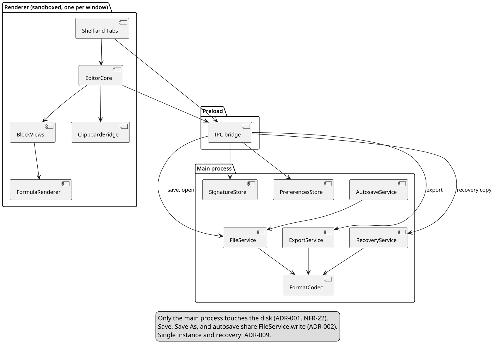
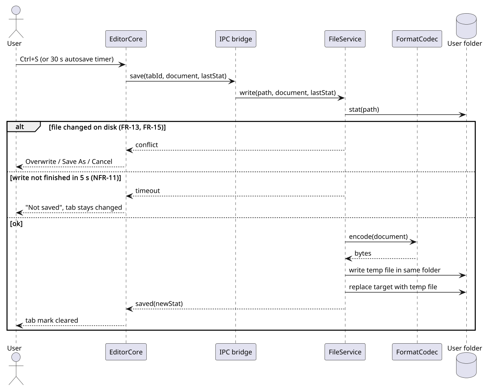
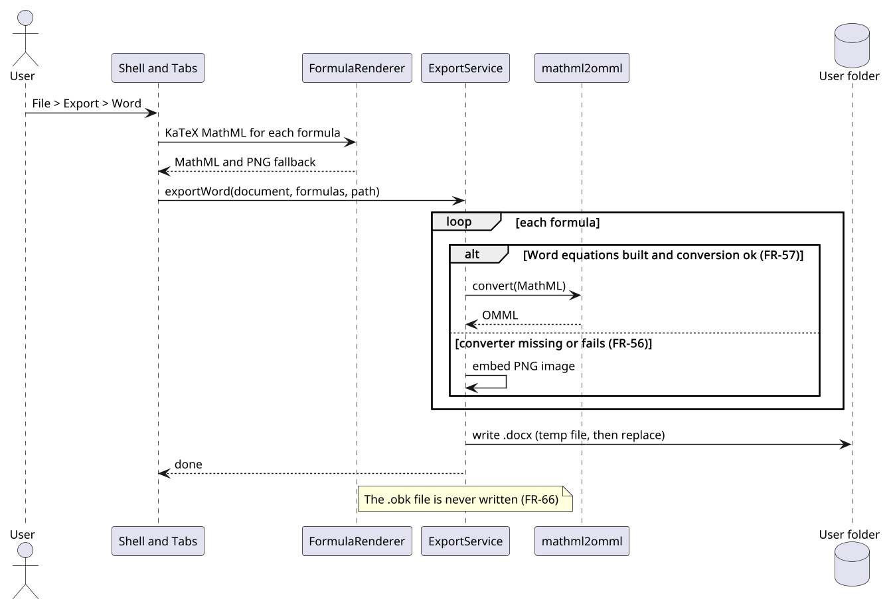
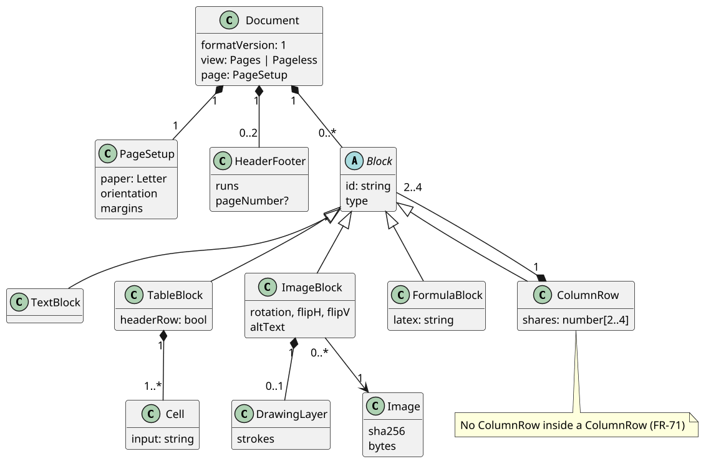
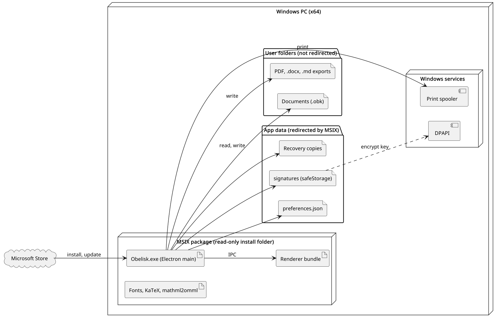
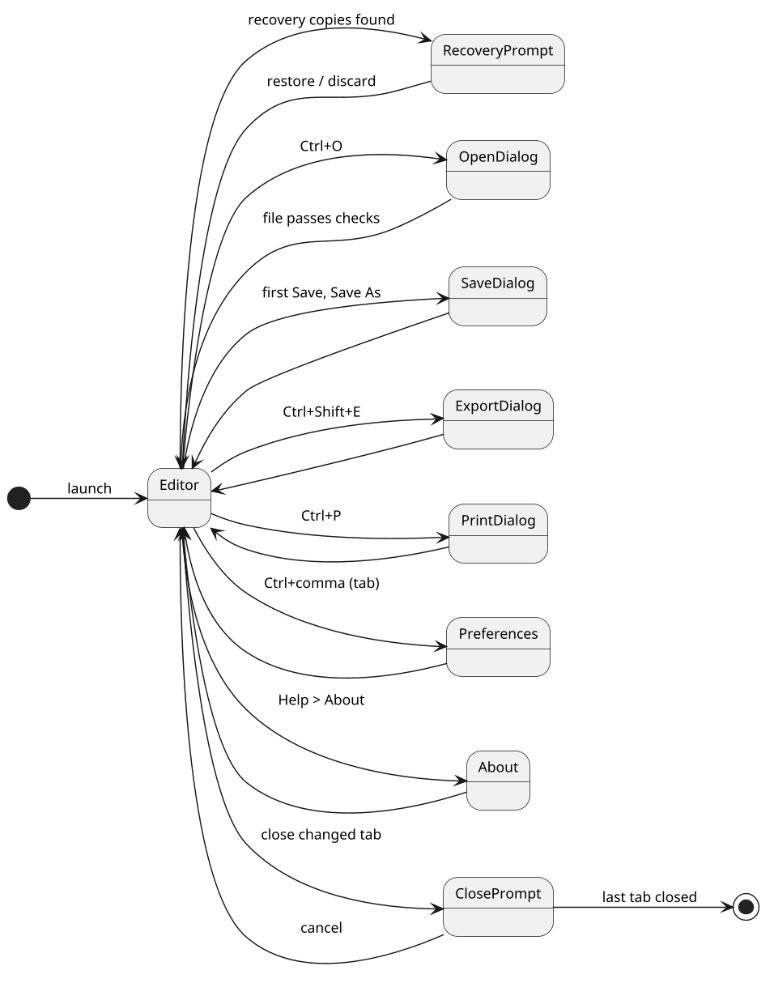
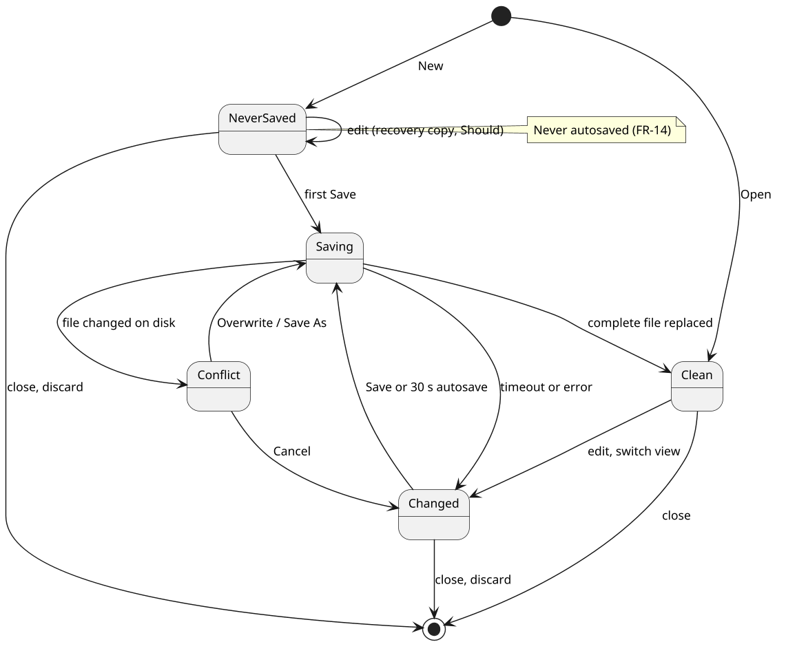

# Architecture and Design: Obelisk

Prepared by: Filliciano Plong · Date: October 23, 2026 · Version: 1.0

**Readers:** Filliciano Plong, sole developer. Helps decide module boundaries, the save path, and the export pipeline before code starts.

## Contents

- [Revision history](#revision-history)
- [1. Context and scope](#1-context-and-scope)
- [2. Goals and constraints](#2-goals-and-constraints)
- [3. Quality-attribute scenarios](#3-quality-attribute-scenarios)
- [4. Architectural style](#4-architectural-style)
- [5. Architecture views](#5-architecture-views)
- [6. Behavior and contract](#6-behavior-and-contract)
- [7. Architecture decisions](#7-architecture-decisions)
- [8. Risks](#8-risks)
- [9. Technology stack](#9-technology-stack)
- [10. Traceability](#10-traceability)
- [11. Open decisions](#11-open-decisions)
- [12. Maintenance and references](#12-maintenance-and-references)

## Revision history

| Version | Date | Changes |
|---|---|---|
| 1.0 | October 23, 2026 | First release of the architecture. |

## 1. Context and scope

This document shows how Obelisk will meet its SRS. It cites requirement IDs from the SRS (Plong_Obelisk_SRS.docx, version 1.0) instead of repeating them.

Everything here is a proposal until accepted. Technology versions are unverified until the spikes in section 9 confirm them.

### 1.1 Actors

| Actor | Role |
|---|---|
| User | Writes, saves, prints, and exports documents; one person in the student or professional role. |
| Windows | File Explorer, Open and Save dialogs, print spooler, clipboard, spell checker, DPAPI. |
| Microsoft Store | Installs, signs, and updates the MSIX package. |

### 1.2 External dependencies

- Electron (Chromium and Node.js), React, TypeScript.
- A ProseMirror-based editor core (proposal, ADR-004).
- KaTeX for formulas; mathml2omml for Word equations (Should).
- Mermaid for the diagram block (Should, OD-05).
- Bundled fonts: the LibreOffice Latin set plus Dancing Script (OD-08).

### 1.3 Included and excluded

**Included:** SRS sections 6 and 7: every FR and NFR, Must and Should.

**Excluded:** The SRS out-of-scope list (section 2.2) and future features (section 13).

## 2. Goals and constraints

### 2.1 Top quality goals

| Rank | Goal | Requirements |
|---|---|---|
| 1 | No lost or half-written files | NFR-10, NFR-11, NFR-12, NFR-13, NFR-14 |
| 2 | Fast typing and opening in long documents | NFR-01, NFR-02, NFR-03, NFR-04 |
| 3 | Safe with untrusted files and pastes | NFR-06, NFR-07, FR-09, FR-36 |
| 4 | Faithful print and export | FR-62, FR-63, FR-64, FR-56 |

### 2.2 Constraints

| Constraint | Source |
|---|---|
| Electron, React, and TypeScript | Developer decision |
| Microsoft Store MSIX is the only release channel | Developer decision; ADR-008 |
| Solo developer; Shoulds cut in the SRS drop order | Project plan |
| English interface; Letter paper | SRS section 5 |
| mathml2omml is LGPL and ships as a separate module | NFR-29 |

## 3. Quality-attribute scenarios

Each scenario names a stimulus and environment, the expected response, a measure, and how it is checked.

| ID | Stimulus and environment | Response and measure | Verification | IDs | Component |
|---|---|---|---|---|---|
| QS-01 | User types in a 50-page document with tables and formulas, on the reference machine. | Character shows within 50 ms; formulas re-render only when their source changes. | Test: input-latency trace | NFR-01, NFR-02 | EditorCore, FormulaRenderer |
| QS-02 | The app is ended or power is lost during Save or autosave of a large file. | The target holds the old bytes or the complete new file; 20 of 20 runs. | Test: kill during save | NFR-10, NFR-12, NFR-14 | FileService |
| QS-03 | User opens a crafted .obk file, or pastes HTML with scripts and remote images. | Nothing runs and no request is sent; a bad file opens nothing and stays unchanged. | Test: hostile sample set under Node and in the app | FR-09, FR-36, NFR-06, NFR-07 | FormatCodec, ClipboardBridge |
| QS-04 | Another program changes an open file, then autosave fires. | Autosave is skipped; the user chooses Overwrite, Save As, or Cancel; nothing is overwritten silently. | Test: change the file in Notepad | FR-13, FR-15 | AutosaveService, FileService |
| QS-05 | User exports a document with 20 formulas to Word. | Each formula is an editable equation, or an image if conversion fails; done within 10 s. | Test: open in Word | FR-56, FR-57, NFR-04 | ExportService |
| QS-06 | Another Windows user on the same PC reads Obelisk's app data. | Saved signatures are unreadable without the owner's DPAPI key. | Inspection: read the file as another user | NFR-08, NFR-09 | SignatureStore |

## 4. Architectural style

Local-first modular monolith. One Electron main process owns all file, print, and export work. One sandboxed renderer per window owns the editor. They talk only over a narrow, typed IPC bridge exposed by the preload script. This keeps every disk write in one tested place (ADR-001), keeps untrusted content away from Node, and needs no server, which matches NFR-05.

| Component | Process | Responsibility |
|---|---|---|
| Shell and Tabs | Renderer | Window regions, menus, tab strip, status bar, Preferences and About tabs, prompts. |
| EditorCore | Renderer | Document model, typing, shortcuts, slash menu, undo, selection, block moves, find and replace, page layout. |
| BlockViews | Renderer | Views for tables (with the TableMath module), images, columns, drawing, signatures, date chips, diagrams. |
| FormulaRenderer | Renderer | KaTeX rendering, live preview, errors; MathML and PNG for export. |
| ClipboardBridge | Renderer | Copy and paste of blocks; sanitizing pasted HTML per the Paste reference. |
| IPC bridge | Preload | The only path from renderer to main: typed calls, validated arguments. |
| FileService | Main | Open and save dialogs, file checks, the one write path, disk-change check, file activation. |
| FormatCodec | Main | Encode and decode .obk files; schema and limit checks. Runs under Node. |
| AutosaveService | Main | Per-tab 30 s timer after the last edit, for saved documents only. |
| ExportService | Main | Print, PDF, Word, and Markdown exporters behind one interface. |
| SignatureStore | Main | Saved signatures, encrypted with safeStorage. |
| PreferencesStore | Main | Preferences in app data. |
| RecoveryService | Main | Recovery copies of never-saved tabs in app data. |

## 5. Architecture views

Each view is a PlantUML source in docs/diagrams/. Component names match the table in section 4.

### 5.1 Use case view

*Figure 1. Obelisk use cases*

**Purpose:** Shows who uses Obelisk for what; details are in SRS section 8.

**Assumption:** One user; Windows and the Store are supporting actors.

**Limitation:** No flows or errors; see the sequences.

### 5.2 Component view

*Figure 2. Components and dependencies*

**Purpose:** Shows which component owns each responsibility and the one path to disk.

**Assumption:** One window with many tabs; one renderer per window.

**Limitation:** Sub-modules such as TableMath and the exporters are not drawn.

### 5.3 Sequence: save and autosave

*Figure 3. Save and autosave, with conflict and timeout*

**Purpose:** Shows the critical write path and its two failure branches.

**Assumption:** The target is on a local NTFS disk.

**Limitation:** Save As and the first Save add the Save dialog before this flow.

### 5.4 Sequence: export to Word

*Figure 4. Word export with equation fallback*

**Purpose:** Shows how formulas reach Word as equations or images.

**Assumption:** KaTeX MathML is produced in the renderer, where KaTeX runs.

**Limitation:** Other blocks are mapped per the SRS Export reference and are not drawn.

### 5.5 Class view

*Figure 5. Document domain model*

**Purpose:** Shows the entities stored in an .obk file and their multiplicities.

**Assumption:** Format version 1 (OD-02).

**Limitation:** Lists, quotes, and other text blocks are shown as TextBlock.

### 5.6 Deployment view

*Figure 6. Deployment on a Windows PC*

**Purpose:** Shows where each artifact lives and which folders MSIX redirects.

**Assumption:** Per-user MSIX install from the Store.

**Limitation:** MSIX redirection of app data is from Microsoft docs, not yet tested here.

**UNVERIFIED:** MSIX redirects writes to app data but not to user folders such as Documents. Check in spike S-01; source: Microsoft MSIX docs.

### 5.7 Screen flow

*Figure 7. Screen flow*

**Purpose:** Shows how the user moves between the editor, dialogs, and tabs.

**Assumption:** Preferences and About open as tabs, not windows.

**Limitation:** Menus and context menus are not drawn.

### 5.8 State machine: document

*Figure 8. Document save states*

**Purpose:** Shows the save state of one tab and when autosave applies.

**Assumption:** One tab per document.

**Limitation:** Recovery copies are shown only as a NeverSaved self-transition.

## 6. Behavior and contract

The critical operation is saving a document (FR-10, FR-11, FR-14). Figure 3 shows the flow.

### 6.1 Save contract

| Field | Rule |
|---|---|
| Operation | file:save, called by Save, Save As, autosave; one path (ADR-002) |
| Inputs | tabId; document model; target path; expected stat (size and modified time) from the last read or write |
| Outputs | ok with new stat; conflict with current stat; timeout; error with a message |
| Authorization | Only paths the user picked in a dialog or opened in this session; checked in FileService |
| Before writing | stat the target; if it differs from the expected stat, return conflict, write nothing |
| Atomicity | Write a temp file in the same folder, flush, then replace the target in one rename |
| Timeout | 5 s from start (NFR-11); the temp file is removed; the tab stays changed |
| Retry | On EPERM or EBUSY during replace (antivirus, indexer): 3 tries, 100 ms apart, then error |
| State changes | Changed to Saving to Clean on ok; back to Changed on timeout or error; Conflict on conflict |
| Autosave | Same call with the stored path; on conflict it shows the choice once and pauses autosave for that tab |

**UNVERIFIED:** That fs.rename over an existing file maps to an atomic replace (MoveFileEx with replace) on NTFS from an MSIX-packaged app. Check in spike S-01; source: Node.js fs docs and libuv.

### 6.2 Alternatives

| Case | Trigger | Result |
|---|---|---|
| Conflict | Another program changed the file | Return conflict; the user picks Overwrite (save with the new stat), Save As, or Cancel |
| Timeout | No completion within 5 s (slow or network folder) | Return timeout; tab stays changed; status bar says Not saved |
| Error | Disk full, access denied, path gone | Return error with the reason; temp file removed; tab stays changed |

### 6.3 IPC surface

| Channel | Direction | Purpose |
|---|---|---|
| `file:open` | Renderer to main | Show the Open dialog, check, decode, return the document |
| `file:save` | Renderer to main | The contract above |
| `file:saveAs` | Renderer to main | Save dialog, then file:save to the new path |
| `file:activated` | Main to renderer | A file double-clicked in Explorer, for a new tab |
| `export:run` | Renderer to main | Format, target path, document, formula MathML and PNGs |
| `print:run` | Renderer to main | Print the page layout |
| `prefs:get, prefs:set` | Renderer to main | Read and write preferences |
| `sig:list, sig:save, sig:delete` | Renderer to main | Saved signatures |
| `recovery:put, recovery:list, recovery:drop` | Renderer to main | Recovery copies |

### 6.4 Security baseline

- contextIsolation on, sandbox on, nodeIntegration off in every renderer.
- A strict Content Security Policy: no remote scripts, styles, images, or frames.
- Navigation and new windows blocked; links open in the default browser after a prompt.
- The IPC bridge exposes named functions only, and main validates every argument.
- Documents are decoded from JSON into the schema; no stored HTML is ever rendered.

## 7. Architecture decisions

All decisions are Proposed until accepted. Structure: ADR-001. Failure handling: ADR-002.

| ADR | Decision | Status |
|---|---|---|
| ADR-001 | The main process owns all file access | Proposed |
| ADR-002 | Save, Save As, and autosave share one complete-file write path | Proposed |
| ADR-003 | One ZIP container per document | Proposed |
| ADR-004 | Editor built on a ProseMirror-based core with custom block views | Proposed |
| ADR-005 | Formulas: KaTeX on screen and PDF, OMML for Word, image fallback | Proposed |
| ADR-006 | Each exporter is a separate module behind one interface | Proposed |
| ADR-007 | Saved signatures encrypted with safeStorage in app data | Proposed |
| ADR-008 | Microsoft Store MSIX as the only release channel | Proposed |
| ADR-009 | Single instance with file activation, and recovery copies in app data | Proposed |

### ADR-001 The main process owns all file access

| Field | Content |
|---|---|
| Status | Proposed |
| Context | Untrusted files and pastes reach the renderer (NFR-06, NFR-07). Disk access must be in one place (NFR-22). |
| Decision | Only main-process services touch the disk. Renderers call named functions on the IPC bridge; main validates arguments and paths. |
| Alternatives | Node in the renderer: simpler, but any script bug could reach the disk. A local server: needless for one user. |
| Consequences | Smaller attack surface and one place to test. Costs: IPC types to keep in step, and copying the document across IPC on save. |
| Revisit when | Saving very large documents across IPC misses NFR-03. |

### ADR-002 Save, Save As, and autosave share one complete-file write path

| Field | Content |
|---|---|
| Status | Proposed |
| Context | A file must never be left half-written (NFR-10 to NFR-14). Autosave runs often without the user watching (FR-14, FR-15). |
| Decision | FileService has one write operation: check the disk stat, write a temp file in the same folder, then replace the target. Save, Save As, and autosave all call it. |
| Alternatives | Write in place: simpler, but a crash leaves part of a file. Autosave to a side copy: two stores to keep in step. |
| Consequences | One path to test under Node (NFR-21); autosave inherits the conflict and timeout rules. Costs: a temp file per save and leftover cleanup (NFR-14). |
| Revisit when | Saves to network or cloud-synced folders show failures. |

### ADR-003 One ZIP container per document

| Field | Content |
|---|---|
| Status | Proposed |
| Context | A document holds blocks, images, and settings, and must be complete on its own (FR-49, FR-17). |
| Decision | An .obk file is a ZIP with manifest.json, document.json, and an images folder, per the SRS File format reference. |
| Alternatives | One JSON file with base64 images: simple, but large and slow. A folder per document: easy to break by moving files. |
| Consequences | Images stay compact and files are easy to inspect. Costs: ZIP limits and path checks to guard against hostile archives. |
| Revisit when | Format version 2 is needed (OD-02). |

### ADR-004 Editor built on a ProseMirror-based core with custom block views

| Field | Content |
|---|---|
| Status | Proposed |
| Context | Blocks, typed shortcuts, undo, and schema checks are core needs (FR-32, FR-35, FR-37). |
| Decision | Use a ProseMirror-based core with a strict schema. Each block kind is a custom node view in BlockViews. |
| Alternatives | contenteditable from scratch: too much work for one developer. Other editor frameworks: less control over the schema. |
| Consequences | A proven model for undo and input rules. Costs: learning curve; pagination is custom (FR-74). |
| Revisit when | Pages view layout cannot meet NFR-02. |

### ADR-005 Formulas: KaTeX on screen and PDF, OMML for Word, image fallback

| Field | Content |
|---|---|
| Status | Proposed |
| Context | Formulas are the standout feature (FR-53). Word needs native equations (FR-57), but conversion may fail (FR-56). |
| Decision | KaTeX renders on screen and in PDF. For Word, KaTeX MathML goes through mathml2omml; on failure, or if not built, the formula is a PNG. |
| Alternatives | MathJax: heavier. Images only: Word users cannot edit equations. |
| Consequences | Word export never fails because of a formula. Costs: an LGPL module (NFR-29) and possible fidelity gaps (R-01). |
| Revisit when | mathml2omml fidelity is poor on the SRS samples. |

### ADR-006 Each exporter is a separate module behind one interface

| Field | Content |
|---|---|
| Status | Proposed |
| Context | PDF, Word, and Markdown map every block differently (SRS Export reference). HTML and .txt may come later. |
| Decision | ExportService calls one interface, export(document, assets, path); each format is a module testable under Node, except PDF, which uses printToPDF. |
| Alternatives | One exporter with format switches: grows tangled. |
| Consequences | Formats are tested and cut on their own; HTML can be added later. Cost: some shared mapping code. |
| Revisit when | A future format needs a different input than the block tree. |

### ADR-007 Saved signatures encrypted with safeStorage in app data

| Field | Content |
|---|---|
| Status | Proposed |
| Context | Signatures are sensitive (NFR-08, NFR-09). The app has no account or key store. |
| Decision | SignatureStore encrypts each signature with Electron safeStorage (async API) before writing; if encryption is unavailable, it saves nothing and says so. |
| Alternatives | Plain files: readable by any user with access. Own key file: the key sits next to the data. |
| Consequences | Uses DPAPI with no key handling. Limitation: other apps of the same user can decrypt (UNVERIFIED, Electron docs). |
| Revisit when | Electron changes the safeStorage API again. |

### ADR-008 Microsoft Store MSIX as the only release channel

| Field | Content |
|---|---|
| Status | Proposed |
| Context | Release is Store only (NFR-24, NFR-31, NFR-27). |
| Decision | Package as MSIX, per-user, with the .obk file-type association; updates only through the Store. |
| Alternatives | A separate installer: needs code signing and an updater. |
| Consequences | Free signing and updates; clean uninstall. Costs: certification time (R-04) and MSIX file-system rules (R-06). |
| Revisit when | Users ask for a download outside the Store. |

### ADR-009 Single instance with file activation, and recovery copies in app data

| Field | Content |
|---|---|
| Status | Proposed |
| Context | Double-clicked files open as tabs (FR-18). Never-saved tabs need crash safety (FR-19 to FR-21). |
| Decision | Main takes the single-instance lock; a second launch passes its file path through the second-instance event. RecoveryService writes recovery copies to app data with the same temp-then-replace helper. |
| Alternatives | Many windows, one per file: breaks the tab model. Recovery in the user's folder: leaves files the user never asked for. |
| Consequences | One window, one place for recovery. Costs: the lock must release on crash, and the activation path needs an MSIX test (R-06). |
| Revisit when | Users want one window per document. |

## 8. Risks

| ID | Risk | Likelihood | Impact | Mitigation | Owner |
|---|---|---|---|---|---|
| R-01 | mathml2omml output differs from KaTeX for some formulas | Medium | Medium | Test the SRS formula samples in Word early; the image fallback covers failures (FR-56) | Developer |
| R-02 | LGPL terms for mathml2omml inside the MSIX are not met | Low | High | Ship it unbundled as its own module, with source link and license text (NFR-29); check the LGPL text | Developer |
| R-03 | Column rows split across pages differently on screen and in PDF | High | Medium | One layout module used by Pages view and print; PDF compare tests (FR-74) | Developer |
| R-04 | Store certification is delayed near release | Medium | High | Submit a private test build one month before release (NFR-31) | Developer |
| R-05 | Some LibreOffice fonts are not OFL | Medium | Medium | Check each license file before bundling; drop any font that does not fit (OD-08) | Developer |
| R-06 | MSIX file activation or file writes behave differently than expected | Medium | Medium | Spikes S-01 and S-02 in a packaged build before the file features are built | Developer |
| R-07 | Antivirus or indexers lock the target during replace | Medium | Medium | Retry 3 times at 100 ms, then report; never leave a partial file (NFR-10) | Developer |

## 9. Technology stack

| Layer | Technology | Version | Why | License |
|---|---|---|---|---|
| Desktop runtime | Electron | UNVERIFIED (45 or later) | Chromium layout and printToPDF; one codebase | MIT |
| Interface | React, TypeScript | UNVERIFIED | Common and typed | MIT; Apache-2.0 |
| Editor core | ProseMirror-based library (proposal) | UNVERIFIED | Schema, undo, input rules | MIT |
| Math | KaTeX | UNVERIFIED | Fast, offline, MathML output | MIT |
| Word math | mathml2omml | 0.5.0 (npm) | MathML to OMML | LGPL-3.0-or-later |
| Word file | A .docx writer library (proposal) | UNVERIFIED | Builds .docx under Node | UNVERIFIED |
| PDF and print | Electron printToPDF and print | With Electron | Same layout as the screen | MIT |
| Diagram | Mermaid (proposal) | UNVERIFIED | Text diagrams, offline | MIT (UNVERIFIED) |
| ZIP | A ZIP library for Node (proposal) | UNVERIFIED | Reads and writes .obk | UNVERIFIED |
| Tests | A Node test runner with coverage (proposal) | UNVERIFIED | NFR-21, NFR-23 | UNVERIFIED |
| Packaging | MSIX tooling for Electron (proposal) | UNVERIFIED | Store package | UNVERIFIED |

**UNVERIFIED:** Versions and the licenses marked UNVERIFIED. Fix them after the spikes below, from each project's package page.

### 9.1 Spikes

| Spike | Question | Settles |
|---|---|---|
| S-01 | In a packaged MSIX build, save to Documents and confirm the write is not redirected and the rename replaces the file in one step. | R-06, R-07 |
| S-02 | Double-click an .obk file with Obelisk running; confirm the path arrives through the second-instance event. | R-06 |
| S-03 | Convert the SRS formula samples with mathml2omml and open them in Word. | R-01 |
| S-04 | Render a Mermaid flowchart in a sandboxed renderer with the network off. | OD-05 |
| S-05 | Confirm whether the Windows Save dialog asks before replacing a file, as Electron sets it. | FR-12 |

## 10. Traceability

Every Must FR maps to at least one component. Package-wide requirements map to the build and release process.

| Requirement | Priority | Component | ADR | Verification |
|---|---|---|---|---|
| FR-01 | Must | Shell and Tabs | - | Demo |
| FR-02 | Must | Shell and Tabs | - | Inspection |
| FR-03 | Must | Shell and Tabs | - | Test |
| FR-04 | Must | Shell and Tabs | - | Test |
| FR-05 | Must | Shell and Tabs | - | Inspection |
| FR-06 | Must | PreferencesStore | - | Test |
| FR-07 | Must | Shell and Tabs | - | Test |
| FR-08 | Must | FileService | - | Test |
| FR-09 | Must | FormatCodec | - | Test |
| FR-10 | Must | FileService | - | Test |
| FR-11 | Must | FileService | - | Demo |
| FR-12 | Must | FileService | - | Test |
| FR-13 | Must | FileService | - | Test |
| FR-14 | Must | AutosaveService | ADR-002 | Test |
| FR-15 | Must | AutosaveService | ADR-002 | Test |
| FR-16 | Must | Shell and Tabs | - | Test |
| FR-17 | Must | FormatCodec | ADR-003 | Test |
| FR-18 | Should | FileService | ADR-009 | Demo |
| FR-19 | Should | RecoveryService | ADR-009 | Inspection |
| FR-20 | Should | Shell and Tabs | - | Test |
| FR-21 | Should | RecoveryService | ADR-009 | Inspection |
| FR-22 | Must | EditorCore | - | Test |
| FR-23 | Must | Shell and Tabs | - | Test |
| FR-24 | Must | EditorCore | - | Test |
| FR-25 | Must | EditorCore | - | Test |
| FR-26 | Must | EditorCore | - | Test |
| FR-27 | Must | EditorCore | - | Inspection |
| FR-28 | Must | EditorCore | - | Test |
| FR-29 | Must | EditorCore | - | Test |
| FR-30 | Must | EditorCore | - | Test |
| FR-31 | Must | EditorCore | - | Demo |
| FR-32 | Must | EditorCore | ADR-004 | Test |
| FR-33 | Must | EditorCore | - | Demo |
| FR-34 | Must | EditorCore | - | Test |
| FR-35 | Must | EditorCore | ADR-004 | Test |
| FR-36 | Must | ClipboardBridge | - | Test |
| FR-37 | Must | EditorCore | ADR-004 | Test |
| FR-38 | Must | EditorCore | - | Test |
| FR-39 | Must | ClipboardBridge | - | Test |
| FR-40 | Must | EditorCore | - | Test |
| FR-41 | Must | ClipboardBridge | - | Test |
| FR-42 | Must | EditorCore | - | Test |
| FR-43 | Must | EditorCore | - | Test |
| FR-44 | Must | EditorCore | - | Inspection |
| FR-45 | Must | BlockViews | - | Test |
| FR-46 | Must | BlockViews | - | Test |
| FR-47 | Must | BlockViews | - | Test |
| FR-48 | Must | BlockViews | - | Test |
| FR-49 | Must | BlockViews | ADR-003 | Test |
| FR-50 | Must | BlockViews | - | Test |
| FR-51 | Must | BlockViews | - | Test |
| FR-52 | Must | BlockViews | - | Inspection |
| FR-53 | Must | FormulaRenderer | ADR-005 | Test |
| FR-54 | Must | FormulaRenderer | - | Demo |
| FR-55 | Must | FormulaRenderer | - | Test |
| FR-56 | Must | ExportService | ADR-005 | Test |
| FR-57 | Should | ExportService | ADR-005 | Test |
| FR-58 | Must | EditorCore | - | Test |
| FR-59 | Must | EditorCore | - | Test |
| FR-60 | Must | EditorCore | - | Test |
| FR-61 | Must | ExportService | - | Demo |
| FR-62 | Must | ExportService | - | Test |
| FR-63 | Must | ExportService | - | Test |
| FR-64 | Must | ExportService | - | Test |
| FR-65 | Must | ExportService | - | Test |
| FR-66 | Must | ExportService | - | Test |
| FR-67 | Should | BlockViews | - | Test |
| FR-68 | Should | BlockViews | - | Test |
| FR-69 | Should | BlockViews | - | Test |
| FR-70 | Should | BlockViews | - | Test |
| FR-71 | Should | BlockViews | - | Test |
| FR-72 | Should | BlockViews | - | Test |
| FR-73 | Should | BlockViews | - | Test |
| FR-74 | Should | BlockViews | ADR-004 | Test |
| FR-75 | Should | BlockViews | - | Test |
| FR-76 | Should | BlockViews | - | Test |
| FR-77 | Should | ExportService | - | Inspection |
| FR-78 | Should | BlockViews | - | Test |
| FR-79 | Should | SignatureStore | - | Test |
| FR-80 | Should | BlockViews | - | Inspection |
| FR-81 | Should | ExportService | - | Test |
| FR-82 | Should | BlockViews | - | Test |
| FR-83 | Should | BlockViews | - | Test |
| NFR-01 | Must | Build and release | - | Test |
| NFR-02 | Must | EditorCore | ADR-004 | Test |
| NFR-03 | Must | FileService | ADR-001 | Test |
| NFR-04 | Must | ExportService | - | Test |
| NFR-05 | Must | Build and release | - | Analysis |
| NFR-06 | Must | ClipboardBridge | ADR-001 | Test |
| NFR-07 | Must | FormatCodec | ADR-001 | Test |
| NFR-08 | Should | SignatureStore | ADR-007 | Inspection |
| NFR-09 | Should | SignatureStore | ADR-007 | Test |
| NFR-10 | Must | FileService | ADR-002 | Test |
| NFR-11 | Must | FileService | - | Test |
| NFR-12 | Must | FileService | - | Test |
| NFR-13 | Must | AutosaveService | - | Test |
| NFR-14 | Must | FileService | ADR-002 | Test |
| NFR-15 | Must | Shell and Tabs | - | Test |
| NFR-16 | Must | Shell and Tabs | - | Test |
| NFR-17 | Must | Shell and Tabs | - | Analysis |
| NFR-18 | Must | Shell and Tabs | - | Inspection |
| NFR-19 | Must | Shell and Tabs | - | Inspection |
| NFR-20 | Should | Shell and Tabs | - | Demo |
| NFR-21 | Must | FormatCodec | ADR-002 | Inspection |
| NFR-22 | Must | IPC bridge | ADR-001 | Inspection |
| NFR-23 | Should | Build and release | - | Analysis |
| NFR-24 | Must | Build and release | ADR-008 | Test |
| NFR-25 | Must | Build and release | - | Test |
| NFR-26 | Must | PreferencesStore | - | Inspection |
| NFR-27 | Must | Build and release | ADR-008 | Test |
| NFR-28 | Must | Build and release | - | Inspection |
| NFR-29 | Must | Build and release | ADR-005 | Inspection |
| NFR-30 | Must | Build and release | - | Inspection |
| NFR-31 | Must | Build and release | ADR-008 | Demo |

### 10.1 Quality scenarios

| QS | Component | View | Verification |
|---|---|---|---|
| QS-01 | EditorCore, FormulaRenderer | Figure 2 | Test: input-latency trace |
| QS-02 | FileService | Figures 2, 3 | Test: kill during save |
| QS-03 | FormatCodec, ClipboardBridge | Figure 2 | Test: hostile sample set under Node and in the app |
| QS-04 | AutosaveService, FileService | Figure 2 | Test: change the file in Notepad |
| QS-05 | ExportService | Figure 2 | Test: open in Word |
| QS-06 | SignatureStore | Figure 2 | Inspection: read the file as another user |

## 11. Open decisions

These SRS open decisions affect the architecture. IDs match the SRS.

| ID | Question | Proposed default | Status |
|---|---|---|---|
| OD-02 | File extension and format version | .obk, format 1, after checking it is not widely used | Open |
| OD-03 | Autosave interval | Within 30 s of the last edit, as a target | Open |
| OD-05 | Diagram engine and syntax | Mermaid, bundled, offline; license to verify | Open |
| OD-08 | Exact bundled fonts and licenses | LibreOffice Latin set plus Dancing Script, each license checked | Open |
| OD-11 | Supported Windows versions | Windows 11 and Windows 10 22H2, x64 | Open |
| OD-07 | Crash safety for never-saved tabs | Should: recovery copy every 30 s | Decided 2026-10-23 |
| OD-12 | Open from File Explorer | Should: one window, new tab per file | Decided 2026-10-23 |

## 12. Maintenance and references

| Item | Detail |
|---|---|
| Author | Filliciano Plong |
| Version and date | 1.0, October 23, 2026 |
| Update when | An ADR changes status, a component is added or renamed, or a spike changes a decision |
| Diagram sources | docs/diagrams/*.puml, rendered to docs/images/; shipped in Plong_Obelisk_DiagramSources.zip |

### 12.1 References

- Obelisk SRS (Plong_Obelisk_SRS.docx), version 1.0.
- arc42 template: arc42.org. C4 model: c4model.com.
- Electron security checklist: electronjs.org/docs/latest/tutorial/security.
- Electron safeStorage: electronjs.org/docs/latest/api/safe-storage.
- Electron app.requestSingleInstanceLock: electronjs.org/docs/latest/api/app.
- MSIX file system behavior: learn.microsoft.com/windows/msix/desktop/desktop-to-uwp-behind-the-scenes.
- mathml2omml: npmjs.com/package/mathml2omml.
