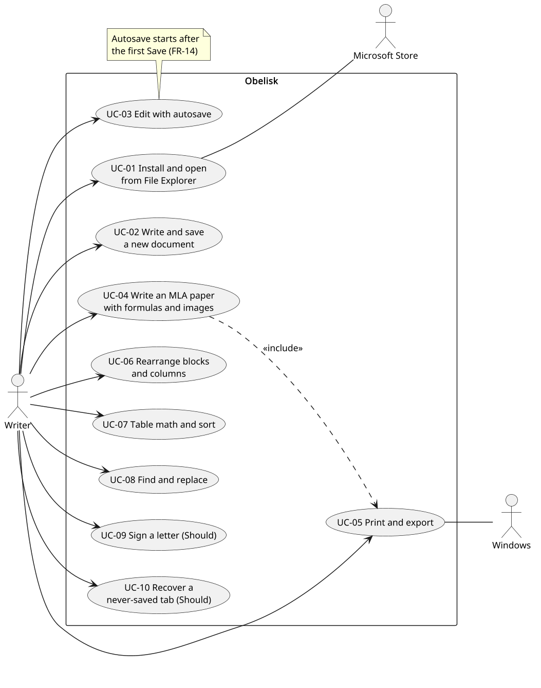
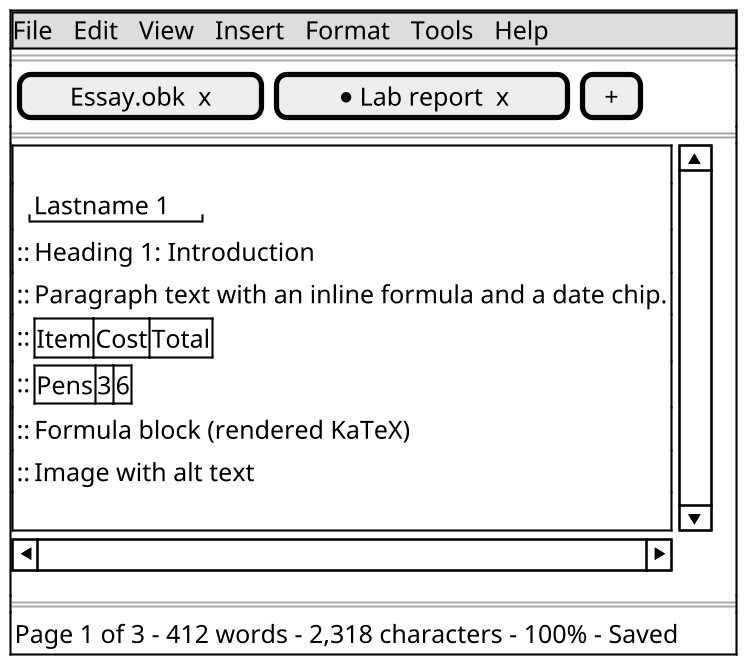

# Software Requirements Specification: Obelisk

Prepared by: Filliciano Plong · Date: October 27, 2026 · Version: 1.3

**Readers:** Filliciano Plong, developer and tester of Obelisk and Dr. Celly, CSC 481 instructor and reviewer.

## Contents

- [Revision history](#revision-history)
- [1. Introduction](#1-introduction)
- [2. Scope](#2-scope)
- [3. Overall description](#3-overall-description)
- [4. User classes](#4-user-classes)
- [5. Constraints and assumptions](#5-constraints-and-assumptions)
- [6. Functional requirements](#6-functional-requirements)
- [7. Non-functional requirements](#7-non-functional-requirements)
- [8. Use cases](#8-use-cases)
- [9. Data requirements](#9-data-requirements)
- [10. External interfaces](#10-external-interfaces)
- [11. Open decisions](#11-open-decisions)
- [12. Acceptance criteria](#12-acceptance-criteria)
- [13. Future features](#13-future-features)
- [14. Traceability](#14-traceability)
- [References](#references)
- [Appendix: Interface sketch](#appendix-interface-sketch)

## Revision history

| Version | Date | Changes |
|---|---|---|
| 1.0 | October 23, 2026 | First release of the requirements. |
| 1.1 | October 23, 2026 | Applied the design, data model, and security review fixes. Added decisions OD-13 to OD-21. |
| 1.2 | October 26, 2026 | Added the Word export and .obk file libraries (docx, JSZip, yauzl, yazl) to the license reference and the software libraries table. |
| 1.3 | October 27, 2026 | Recorded spikes S-01 to S-09 and owner decisions on decoding, elkjs, and diagram click links. Applied the approved menu wording and named the link handler owner. |

## 1. Introduction

### 1.1 Purpose

This document defines what Obelisk must do and how well. Obelisk is a document editor for Windows, for one person on one PC. It writes pages, lays them out, and prints or exports them.

### 1.2 Intended audience

Filliciano Plong, the sole developer, uses this document to plan, build, and test Obelisk. Sections 6 and 7 hold the requirements; section 12 says how each is accepted.

### 1.3 Problem statement

Papers, letters, and problem sets need real pages, good math, and clean exports. Web editors need an account and a connection; full office suites are heavy and weak at math. Obelisk is a local editor that lays out real pages, makes equations easy, and exports to PDF, Word, and Markdown.

### 1.4 Product overview

Obelisk is an editor-only document processor. Each document is one .obk file in an ordinary Windows folder, and open documents sit in tabs. A page is built from blocks: text, headings, lists, tables, images, and equations. The equation block is the standout feature. Obelisk is built with Electron and released only through the Microsoft Store.

### 1.5 Definitions

| Term | Meaning |
|---|---|
| Document | One .obk file: blocks, images, page setup, header, footer, and view. |
| Tab | One open document in the window. Settings and About also open as tabs. |
| Block | One piece of the page, such as a paragraph, table, image, or equation. Listed in the [*Block types reference*](#block-types-reference). |
| Block handle | The grip left of a block, used to select, drag, and open the block menu. |
| Inline item | Something inside a line of text: a link, an inline equation, or a date and time item. |
| Pages view | Separate Letter pages with margins, headers, and footers. Always used for print and PDF. |
| Pageless view | One long page with no page edges. Headers and footers are hidden on screen. |
| Autosave | Writing a saved document to its own file shortly after each edit. |
| Recovery copy | A hidden copy of a never-saved tab, kept in app data in case of a crash. |
| Session | The list of open files kept in app data while Restore tabs on launch is on. |
| Manifest | The manifest.json entry of an .obk file: format name, version, and image list. |
| Slash menu | The block menu that opens when / is typed in an empty line. |
| Typed shortcut | Markdown-style characters that turn into formatting or a block as they are typed. |
| Equation block | A block of display math written in LaTeX and drawn by KaTeX. |
| Inline equation | Math inside a line of text, typed between \$ signs. |
| Date and time item | An inline item holding one fixed date and time. |
| Column row | Two to four blocks side by side, each with a share of the text width. |
| Drawing layer | Strokes drawn over an image, kept with that image. |
| Signature block | A visual signature: an image of a signature with an optional line and labels. Not a verified digital signature. |
| App data | The per-user folder where Obelisk keeps settings, the session, signatures, and recovery copies. MSIX redirects it. |
| MSIX | The Windows app package format that the Microsoft Store installs and signs. |
| KaTeX | An open-source library that draws LaTeX math in HTML and MathML. |
| MathML, OMML | Markup for math: MathML on the web, OMML (Office Math) inside Word files. |
| GFM | GitHub Flavored Markdown, the Markdown dialect used for export and typed shortcuts. |
| LGPL, OFL | GNU Lesser General Public License; SIL Open Font License. |
| DPAPI | The Windows Data Protection API, used by Electron safeStorage on Windows. |
| MoSCoW | Priority scheme: Must, Should, Could. This document uses Must and Should. |

### 1.6 Related documents

Lists of features, keys, and limits are in the named reference tables in the References section at the end.

- Obelisk architecture document (Plong_Obelisk_Architecture.docx), version 1.3.
- Electron documentation, safeStorage API: electronjs.org/docs/latest/api/safe-storage.
- Electron security checklist: electronjs.org/docs/latest/tutorial/security.
- KaTeX documentation, supported functions: katex.org/docs/supported.html.
- KaTeX documentation, options: katex.org/docs/options.html.
- Mermaid configuration schema: mermaid.js.org/config/schema-docs/config.html.
- mathml2omml on npm (version 0.5.0, LGPL-3.0-or-later): npmjs.com/package/mathml2omml.
- GitHub Flavored Markdown specification: github.github.com/gfm.
- Microsoft Store policies and app certification requirements: learn.microsoft.com/windows/apps/publish.
- WCAG 2.1: w3.org/TR/WCAG21.
- MLA Handbook, 9th edition (for the MLA template).

## 2. Scope

Obelisk is an editor only. Files live in Windows folders and open documents sit in tabs. Section 4 describes who uses it.

### 2.1 In scope

- Install Obelisk from the Microsoft Store and open .obk files from File Explorer.
- Create, open, edit, and save documents in any Windows folder.
- Work on several documents at once, one per tab.
- Lay out Letter pages with headers, footers, and page numbers, or write pageless.
- Format text, and build pages from blocks, tables, images, and equations.
- Move and copy blocks within a document, between tabs, and to other apps.
- Print, and export to PDF, Word, and Markdown.
- Should: date and time items, columns, drawing, signatures, diagrams, and crash recovery for never-saved tabs.

### 2.2 Out of scope

- A folder tree, starfield, or calendar view.
- Imports of any format, including Polaris .plr files.
- Templates other than MLA.
- A different first page for headers and footers.
- Settings for the default view, the undo depth, or Markdown shortcuts.
- Verified (cryptographic) digital signatures.
- Accounts, cloud sync, and collaboration.
- Releases outside the Microsoft Store, or for macOS or Linux.

Deferred items with reasons are in section 13.

## 3. Overall description

### 3.1 Product context

Obelisk is a standalone desktop app with no server. It uses Windows for file dialogs, printing, the clipboard, spell checking, and DPAPI. Files are ordinary files in the user's folders.

### 3.2 Main functions

- Tabs, menus, status bar, and Settings (6.1, 6.2).
- Files: open, check, save, autosave, and recovery (6.3).
- Page layout, formatting, and blocks (6.4 to 6.8).
- Tables, images, and equations (6.9 to 6.11).
- Find and Replace, print, and export (6.12, 6.13).
- Should features: date and time items, columns, drawing, signatures, diagrams (6.14 to 6.18).

### 3.3 Operating environment

- Windows 11 or Windows 10 22H2, x64 (OD-11).
- Installed from the Microsoft Store as an MSIX package for the current user.
- A printer driver, or Microsoft Print to PDF.
- Reference machine for targets: 4-core x64 laptop, 8 GB memory, SSD, 1920 by 1080, Windows 11.

## 4. User classes

| Class | Role | Experience | Main tasks | Frequency |
|---|---|---|---|---|
| Student | Writes papers and problem sets to hand in | Uses a word processor; knows some LaTeX | MLA paper, equations, tables, PDF hand-in | Daily |
| Professional | Writes letters, briefs, and simple forms | Uses a word processor; no LaTeX | Signed letter, Word export for others to edit | Weekly |

These are two example roles of one person, not two accounts. Either may use the keyboard only or Windows Narrator.

## 5. Constraints and assumptions

### 5.1 Constraints

| Constraint | Source |
|---|---|
| Built with Electron, React, and TypeScript. | Developer decision |
| Released only through the Microsoft Store as an MSIX package. | Developer decision |
| Publishing needs a Partner Center account and a reserved app name (OD-01). | Microsoft Partner Center |
| Letter paper only; English interface. | Developer decision |
| Solo developer; scope is cut in the Should drop order if time runs short. | Project plan |
| Equations use KaTeX; Word equations use mathml2omml, which is LGPL. | Developer decision; library licenses |
| Bundled fonts: the LibreOffice Latin set plus Dancing Script (OD-08). | Developer decision |

### 5.2 Assumptions

| Assumption | How to validate |
|---|---|
| The user works on one Windows PC. | Confirm with the two user roles; no sync is asked for. |
| Word for Windows opens the exported .docx, including OMML equations. | Checked in Microsoft 365 Version 2610. Spike S-03 opened the six Equation reference samples as editable equations. Spike S-09 opened the Export reference rows, the same six samples as equations and as images, and a 50-page file. |
| GitHub renders the exported Markdown, including math and Mermaid. | Push a test export to a scratch repo. |
| Saving files to the user's folders is not redirected by MSIX. | Checked in spike S-01 on 27 October 2026, Windows 11 Home 10.0.26300, Electron 45.0.0, commit 8f4c177. Documents on that PC is OneDrive Known Folder Move, and a local Desktop folder was the second folder. Both writes landed on the real path. App data was redirected, and a document must not default to that folder. See architecture section 5.6. |
| The PC has a printer driver or Microsoft Print to PDF. | Default on Windows 10 and 11. |

## 6. Functional requirements

Each line is one testable behavior with one MoSCoW priority. Must is required for release. Should is planned, and is cut in the order below if time runs short.

Verification is Test, Demo, Inspection, or Analysis. Lines flagged UNVERIFIED rest on a claim still to check.

**Should drop order.** Date and time items and columns are Shoulds outside this list.

1. Diagram block (6.18).
2. Drawing pad and tools, including drawing over images (6.16).
3. Signature block (6.17). If the drawing pad is already cut, signatures keep the typed and image modes.
4. Word equations (FR-57). The image fallback in FR-56 covers equations in Word.

### 6.1 Window and shell

Obelisk is one window. Open documents sit in tabs; there is no folder tree.

| ID | Requirement | Priority | Verification |
|---|---|---|---|
| FR-01 | The system shall show one window with a menu bar, a tab strip, the page, and a status bar. | Must | Demo: launch and point out each region. |
| FR-02 | The system shall offer the menus and items in the [*Menus reference*](#menus-reference), each enabled only when it applies. | Must | Inspection: compare each menu with the reference. |
| FR-03 | The system shall open each document in its own tab and mark a tab that has unsaved changes. | Must | Test: open three files, edit one, check its mark. |
| FR-04 | The system shall show page, word, and character counts, zoom, and save state, including Autosave paused, in the status bar. | Must | Test: compare counts with a known sample; after a conflict Cancel, Autosave paused shows. |

### 6.2 Settings

Settings hold only what the user may change. Undo depth, the default view, and Markdown shortcuts are fixed, not settings.

| ID | Requirement | Priority | Verification |
|---|---|---|---|
| FR-05 | The system shall open Settings in a tab, offering the options in the [*Settings reference*](#settings-reference). | Must | Inspection: compare the page with the reference. |
| FR-06 | The system shall keep settings in app data and apply them again after a restart. | Must | Test: set Dark, restart, check the theme. |

### 6.3 Files

Each document is one .obk file in an ordinary Windows folder. Saving is the user's choice until the first Save; after that, autosave keeps the file current.

| ID | Requirement | Priority | Verification |
|---|---|---|---|
| FR-07 | The system shall create a new, never-saved document in a new tab on File > New. | Must | Test: New opens an empty tab and writes no file. |
| FR-08 | The system shall open a file chosen in the Windows Open dialog, which lists only Obelisk (.obk) files. | Must | Test: the dialog filter shows only .obk files. |
| FR-09 | The system shall open nothing for a file failing the [*File format reference*](#file-format-reference) checks, leave it unchanged, and say why. | Must | Test: a renamed text file, a damaged file, a newer-version file, and each hostile sample stay byte-for-byte unchanged. |
| FR-10 | The system shall write the open document to its own file on Save. | Must | Test: save, reopen, compare content. |
| FR-11 | The system shall ask for a folder and name in the Windows Save dialog on Save as or first Save. | Must | Demo: Save as writes a new file; the old file is unchanged. |
| FR-12 | The system shall get the user's confirmation before Save as or an export replaces an existing file. | Must | Test: Cancel at the prompt leaves the existing file unchanged. |
| FR-13 | The system shall offer Overwrite, Save as, or Cancel before saving over a file another program changed. | Must | Test: change the file in another program, then save in Obelisk. |
| FR-14 | The system shall autosave a changed document within 30 seconds of its last edit (target), once it has been saved. | Must | Test: a never-saved tab writes nothing; a saved one is on disk 30 s after an edit. |
| FR-15 | The system shall skip an autosave and show the FR-13 choice when the file changed on disk. | Must | Test: change the file in another program, then edit in Obelisk. |
| FR-16 | The system shall ask to save, discard, or cancel when a tab or the app closes with unsaved changes. | Must | Test: close a changed tab, and exit with one. |
| FR-17 | The system shall store each document's view, Pages or Pageless, in its file and reopen it in that view. | Must | Test: save in Pageless, close, reopen. |
| FR-18 | The system shall open a double-clicked .obk file in Obelisk, in a new tab if Obelisk is already running. | Should | Demo: double-click two files from File Explorer; one window, two tabs. |
| FR-19 | The system shall keep a hidden recovery copy of each changed, never-saved tab in app data every 30 seconds. | Should | Inspection: the copy appears in app data within 30 s of an edit. |
| FR-20 | The system shall offer each recovery copy at every launch, to restore or discard, until the user chooses. | Should | Test: end Obelisk from Task Manager, restart, close the prompt, restart; the copy is offered again. |
| FR-21 | The system shall delete a tab's recovery copy when that tab is saved or discarded. | Should | Inspection: the copy is gone after Save and after Discard. |

Checked in spike S-05 on 27 October 2026, Windows 11 Home 10.0.26300, Electron 45.0.0, commit 7ea3b12. For Save as (`.obk`) and Export (`.docx`), `dialog.showSaveDialog` is owned by the app window. The Windows replace prompt appeared and stayed until a click. That includes a name typed without the extension, when the filter supplied `.obk` or `.docx`.

Replace returned the existing path. Cancel returned canceled and left the file unchanged. The dialog did not write the file.

Obelisk relies on that Windows prompt for Save as and Export. It does not show a second prompt. Obelisk's own prompt stays the fallback for another platform, or if a later Windows build stops asking.

Checked in spike S-02 on 27 October 2026, Windows 11 Home 10.0.26300, Electron 45.0.0, commit 0f95f5f, package Obelisk.SpikeS02 0.0.1.0. A double-clicked file reached the process on a cold start through argv. A second double-click reached the running process through `app.requestSingleInstanceLock` and the `second-instance` event. One window stayed open.

Selecting three files and pressing Enter delivered three `second-instance` events, one path each. Open with, and the app execution alias, also put the path on argv.

The `second-instance` argv includes Chromium switches before the path. Main takes the file paths out of argv. It does not read a fixed index.

Explorer set the working directory to `C:\WINDOWS\System32`. A relative path is not resolved against that directory.

FR-18 keeps this design (ADR-009). The unused fallback was to drop FR-18, or to use an MSIX activation object. This run did not need that. `Windows.ApplicationModel.AppInstance.GetActivatedEventArgs` is not on Electron's `app` object.

### 6.4 Page view and layout

Pages view shows separate Letter pages. Pageless view shows one long page with no page edges. Print and PDF always use the page layout.

| ID | Requirement | Priority | Verification |
|---|---|---|---|
| FR-22 | The system shall open every new document in Pages view, showing separate Letter pages. | Must | Test: File > New opens in Pages view. |
| FR-23 | The system shall switch a document between Pages and Pageless from the View menu, marking it changed. | Must | Test: switch the view; the tab shows unsaved changes. |
| FR-24 | The system shall set orientation and margins as listed in the [*Page setup reference*](#page-setup-reference), stored in the file. | Must | Test: each margin preset changes the text width; reopen keeps it. |
| FR-25 | The system shall show an editable header and footer on every page, with the fields in the [*Page setup reference*](#page-setup-reference). | Must | Test: a three-page document numbers 1, 2, 3 on screen and in the PDF. |
| FR-26 | The system shall start a new page at the cursor on Ctrl+Enter or Insert > Page break. | Must | Test: text after the break starts on the next page. |
| FR-27 | The system shall create a new document from the MLA template, as set in the [*MLA template reference*](#mla-template-reference). | Must | Inspection: compare the new document with the reference. |

### 6.5 Text formatting

Formatting applies to text in any block that holds text, including table cells.

| ID | Requirement | Priority | Verification |
|---|---|---|---|
| FR-28 | The system shall apply and clear the character formatting, fonts, and sizes in the [*Formatting reference*](#formatting-reference). | Must | Test: apply each mark, then Clear formatting. |
| FR-29 | The system shall set alignment, line spacing, and space before and after each paragraph, per the [*Formatting reference*](#formatting-reference). | Must | Test: each value changes the layout on screen and in the PDF. |
| FR-30 | The system shall set left, first-line, and hanging indents per paragraph, per the [*Formatting reference*](#formatting-reference). | Must | Test: a hanging indent of 0.5 in on a Works Cited entry. |
| FR-31 | The system shall underline misspelled words and offer suggestions from the Windows spell checker. | Must | Demo: misspell a word, pick a suggestion from the text menu. |

**UNVERIFIED:** FR-31 assumes Electron uses the Windows spell checker on Windows and returns suggestions to the context menu. Check: Electron spellchecker docs.

### 6.6 Blocks and typing

A document is a list of blocks. Each block has a handle on its left for selecting, dragging, and its menu.

| ID | Requirement | Priority | Verification |
|---|---|---|---|
| FR-32 | The system shall provide every block in the [*Block types reference*](#block-types-reference), any number of each. | Must | Test: insert two of each block, save, reopen. |
| FR-33 | The system shall show a block handle beside the block under the pointer or the cursor. | Must | Demo: move the pointer and the cursor over blocks. |
| FR-34 | The system shall open the slash menu on / in an empty line, listing [*Slash menu reference*](#slash-menu-reference) items in order. | Must | Test: type /tab and choose Table. |
| FR-35 | The system shall always apply the typed shortcuts in the [*Keyboard reference*](#keyboard-reference), following its rules. | Must | Test: type each shortcut; Ctrl+Z restores the typed characters. |
| FR-36 | The system shall paste from other apps only what the [*Paste reference*](#paste-reference) keeps. | Must | Test: paste a web page with a script, a style, and a remote image. |
| FR-37 | The system shall undo and redo up to 100 steps per tab, kept through Save until the tab closes. | Must | Test: 101 edits, then 100 undos; Save keeps the history. |

### 6.7 Block selection and clipboard

Blocks can be moved and copied as whole units, within a document, between tabs, and to other apps.

| ID | Requirement | Priority | Verification |
|---|---|---|---|
| FR-38 | The system shall select a block by its handle or Esc, and a range by Shift+clicking another handle. | Must | Test: select three blocks with Shift+click. |
| FR-39 | The system shall cut, copy, and paste selected blocks with Ctrl+X, Ctrl+C, and Ctrl+V, including between tabs. | Must | Test: copy a table from one tab to another. |
| FR-40 | The system shall duplicate the selected blocks directly below them on Ctrl+D. | Must | Test: duplicate two blocks; order is kept. |
| FR-41 | The system shall put copied blocks on the Windows clipboard as rich text, with plain text as a fallback. | Must | Test: paste into Word (rich) and Notepad (plain). |
| FR-42 | The system shall move selected blocks by dragging the handle or with Alt+Shift+Up and Alt+Shift+Down. | Must | Test: move a block up two places by keyboard. |

**UNVERIFIED:** FR-41 assumes Word accepts the HTML clipboard format Electron writes. Check with current Word for Windows.

### 6.8 Context menus

Every block and inline item has a context menu, reachable by mouse and keyboard.

| ID | Requirement | Priority | Verification |
|---|---|---|---|
| FR-43 | The system shall open a context menu on right-click, Shift+F10, or the Menu key. | Must | Test: each way opens the same menu. |
| FR-44 | The system shall show the menu items in the [*Context menus reference*](#context-menus-reference), following its composition rule. | Must | Inspection: compare each menu with the reference. |

### 6.9 Tables

Table cells hold text. A cell that starts with = holds cell-reference arithmetic. There are no named functions.

| ID | Requirement | Priority | Verification |
|---|---|---|---|
| FR-45 | The system shall insert a table, add or delete rows and columns, and toggle a bold header row. | Must | Test: build a 3 by 4 table with a header row; insert a row above a referenced cell; the formula follows it. |
| FR-46 | The system shall compute a cell starting with = as cell-reference arithmetic, per the [*Table math reference*](#table-math-reference). | Must | Test: =B2+B3*2, =(B2-B3)/2, =B2^2, =[B2+B3]**2. |
| FR-47 | The system shall show #DIV/0!, #REF!, or #CYCLE! in a cell whose formula cannot be computed. | Must | Test: =B2/0, a deleted referenced row (its reference becomes #REF!), and a self-reference. |
| FR-48 | The system shall sort table rows by one column, ascending or descending, keeping the header row fixed. | Must | Test: sort numbers and text both ways; row 1 stays. |

### 6.10 Images

Images are stored inside the document file, so the file is complete on its own.

| ID | Requirement | Priority | Verification |
|---|---|---|---|
| FR-49 | The system shall insert an image from a file or the clipboard, within the [*Image reference*](#image-reference) limits. | Must | Test: insert each type and an animated GIF; a 25 MB image and an 8001-pixel image are refused. |
| FR-50 | The system shall resize an image by dragging a corner handle, keeping its aspect ratio. | Must | Test: drag a corner; the ratio is unchanged. |
| FR-51 | The system shall rotate an image by quarter turns and flip it horizontally or vertically. | Must | Test: rotate, flip, save, reopen. |
| FR-52 | The system shall store alt text for each image and write it into Word and Markdown exports. | Must | Inspection: alt text in the .docx and the .md. |

Checked in spike S-06 (Electron 45.0.0, Windows image 20261021.278.1, Ubuntu image 20261023.334.3, CI run 40461995542). Frame counts and frame sizes for GIF and WebP, including animated WebP, are read from the GIF89a blocks and the WebP RIFF chunks before any pixel decode. The first frame used for Word, PDF, and print is a PNG made in the sandboxed renderer from `ImageDecoder` frame 0. See architecture section 6.6.

### 6.11 Equations

The equation block is the standout feature: LaTeX math that renders as typed and exports cleanly.

| ID | Requirement | Priority | Verification |
|---|---|---|---|
| FR-53 | The system shall render LaTeX math with KaTeX in equation blocks and inline equations, per the [*Equation reference*](#equation-reference). | Must | Test: the sample equations in the reference render. |
| FR-54 | The system shall show the rendered equation live below its LaTeX source while the equation is edited. | Must | Demo: type a fraction and watch it render. |
| FR-55 | The system shall show KaTeX's error message in place of an equation that does not parse, still allowing Save. | Must | Test: \\frac{1} shows an error and the file saves. |
| FR-56 | The system shall export each equation to Word as an image when equation conversion is not built or fails. | Must | Test: with conversion off, equations appear as images in Word. |
| FR-57 | The system shall export equations to Word as editable equations, converting KaTeX MathML to OMML with mathml2omml. | Should | Test: open the .docx in Word and edit an equation. |

Checked in spike S-03 (mathml2omml 0.5.0, KaTeX 0.19.1, docx 9.14.0, Microsoft 365 Version 2610 on Windows, 27 October 2026). The six Equation reference samples open in Word as editable equations, display and inline. FR-57 keeps mathml2omml 0.5.0.

The exporter still cleans the OMML before it is written.

The sum's n-ary body is empty, and Word shows an empty placeholder with the summand beside it. The following sibling moves into that body.

Matrix parentheses are plain math runs and do not stretch. Stretchy fences around a matrix, and stretchy `mo` fences in general, become a delimiter with `begChr` and `endChr`.

Display equations are wrapped in `m:oMathPara`. In one sample the display matrix sat at the right edge and the closing parenthesis was cut off.

The dropped thin space in the integral, and the combining circumflex on theta, looked right. They stay as they are.

A formula whose MathML contains `<` uses `mml2omml` with `disableDecode` set, so the XML stays well-formed.

`ImportedXmlComponent.fromXmlString()` in docx 9.14.0 returns a document node. Inserting that node writes an element named `undefined`, and Word refuses the file. The `m:oMath` child is what goes in the paragraph. Spike S-09 saw the same refusal.

Alignment is still unchecked. The Equation reference has no alignment sample.

FR-56 stays the image fallback when a conversion fails.

### 6.12 Find and Replace

Find and Replace works on the active tab only.

| ID | Requirement | Priority | Verification |
|---|---|---|---|
| FR-58 | The system shall open Find or Replace in one bar, with Match case and Whole word options. | Must | Test: each option narrows the matches. |
| FR-59 | The system shall highlight every match, step through matches, and show the match count. | Must | Test: a word used five times shows 5. |
| FR-60 | The system shall replace the current match or all matches, with Replace all as one undo step. | Must | Test: Replace all, then one Ctrl+Z restores every match. |

### 6.13 Print and export

Print and every export use the document as it is on screen, including unsaved changes. HTML and plain-text exports are future features.

| ID | Requirement | Priority | Verification |
|---|---|---|---|
| FR-61 | The system shall print through the Windows print dialog, laid out as Pages view, including unsaved changes. | Must | Demo: print to Microsoft Print to PDF. |
| FR-62 | The system shall export a PDF laid out as Pages view, whichever view is shown. | Must | Test: export from Pageless; the PDF has pages, headers, and footers. |
| FR-63 | The system shall export a Word (.docx) file, mapping each block as listed in the [*Export reference*](#export-reference). | Must | Test: open the export in Word; check each row of the reference. |
| FR-64 | The system shall export GitHub Flavored Markdown (.md), mapping each block as listed in the [*Export reference*](#export-reference). | Must | Test: view the export on GitHub; check each row of the reference. |
| FR-65 | The system shall write a Markdown export's images to a folder beside the .md file, linked by relative paths. | Must | Test: move the .md and its folder together; images still show. An existing folder is named in the replace prompt. |
| FR-66 | The system shall leave the document file unchanged when printing or exporting. | Must | Test: compare the .obk bytes before and after. |

### 6.14 Date and time

A date and time item is an inline item that holds one date and time. It never updates by itself.

| ID | Requirement | Priority | Verification |
|---|---|---|---|
| FR-67 | The system shall insert an inline date and time item, set with a calendar and clock picker and editable later. | Should | Test: insert an item, change its date twice. |
| FR-68 | The system shall show each date and time item in a format from the [*Date formats reference*](#date-formats-reference), Windows by default. | Should | Test: each format shows the example in the reference. |
| FR-69 | The system shall keep a date and time item's value fixed; it never changes to the current date by itself. | Should | Test: reopen the file a day later; the item is unchanged. |

### 6.15 Columns

Columns place blocks side by side in a column row. They exist only on the page; Markdown stacks them.

| ID | Requirement | Priority | Verification |
|---|---|---|---|
| FR-70 | The system shall create columns when a block is dropped on another block's left or right edge, or via /column. | Should | Test: drag an image onto a text block's right edge. |
| FR-71 | The system shall split a column row evenly into two to four columns, never nesting columns. | Should | Test: a fifth column and a column inside a column are refused. |
| FR-72 | The system shall resize column shares by dragging the gap, within the [*Columns reference*](#columns-reference) limits. | Should | Test: drag to the minimum share; it stops there. |
| FR-73 | The system shall turn a column row back into a plain block when only one column remains. | Should | Test: drag one of two blocks out of the row. |
| FR-74 | The system shall lay out column rows across pages by the paging rules in the [*Columns reference*](#columns-reference). | Should | Test: a row near a page end moves whole; a very tall row splits. |

### 6.16 Drawing

Drawing covers the drawing pad block and drawing over an image.

| ID | Requirement | Priority | Verification |
|---|---|---|---|
| FR-75 | The system shall provide a drawing pad block with the tools in the [*Drawing tools reference*](#drawing-tools-reference). | Should | Test: use each tool, save, reopen. |
| FR-76 | The system shall draw over an image on a layer that follows it through resize, rotate, and flip. | Should | Test: draw an arrow, then resize, rotate, and flip the image. |
| FR-77 | The system shall flatten an image's drawing layer into the image when exporting to PDF or Word. | Should | Inspection: the export holds one image with the drawing. |

### 6.17 Signature block

A signature block is a visual signature: an image of a signature on a page. It is not a verified digital signature.

| ID | Requirement | Priority | Verification |
|---|---|---|---|
| FR-78 | The system shall insert a signature block via /signature, created by drawing, typing in a script font, or an image. | Should | Test: create one signature of each kind. |
| FR-79 | The system shall save signatures for reuse in app data, encrypted as stated in NFR-08. | Should | Test: reuse a saved signature in a new document. |
| FR-80 | The system shall offer the line, width, label, alignment, and blank-mode settings in the [*Signature options reference*](#signature-options-reference). | Should | Inspection: compare the settings with the reference. |
| FR-81 | The system shall resize a signature and export it as an image in PDF, Word, and Markdown. | Should | Test: resize, then export to each format. |

### 6.18 Diagram block

A diagram block draws a diagram from short text, for example a flowchart.

| ID | Requirement | Priority | Verification |
|---|---|---|---|
| FR-82 | The system shall render a diagram block from Mermaid text offline, showing the source while editing. | Should | Test: a flowchart renders with the network off. |
| FR-83 | The system shall show an error message in place of a diagram whose source does not parse. | Should | Test: a broken source shows the message. |

Spike S-04 checked Mermaid 12.2.0. The license is MIT. The renderer bundle was 12,325,210 bytes, plus 1,076,572 bytes of KaTeX fonts. A sandboxed Electron 45 renderer made no network request.

A readable flowchart uses a post-process: style attributes move into the diagram stylesheet, only drawing properties are kept, every selector is prefixed with the diagram id, and one style element is allowed with a per-render nonce. `style-src-elem` is `app:` plus that nonce. `style-src-attr` is `'none'`. There is no `'unsafe-inline'`.

APPROVED 27 October 2026. Diagrams use Mermaid's dagre layout. That layout is MIT. elkjs is not shipped, and there is no ELK layout option. Spike S-04 left the layout unset, and Mermaid 12.2.0 then used elk. That choice is not kept.

APPROVED 27 October 2026. Before a diagram is rendered, `click` lines and `href` values are removed from its source. A link cannot be left on the picture.

## 7. Non-functional requirements

Each line has a condition, a measure, one priority, and a verification method. Numbers are targets until measured.

### 7.1 Performance

Numbers are targets on the reference machine in section 5, not yet measured.

| ID | Category | Requirement | Priority | Verification |
|---|---|---|---|---|
| NFR-01 | Performance | The system shall show an editable new tab within 3 seconds of launch (target). | Must | Test: timed on the reference machine. |
| NFR-02 | Performance | The system shall show a typed character within 50 ms in a 50-page document (target). | Must | Test: input-latency trace. |
| NFR-03 | Performance | The system shall open or save a 50-page, 10 MB document within 1 second (target). | Must | Test: timed on a local SSD. |
| NFR-04 | Performance | The system shall export a 50-page document to PDF, Word, or Markdown within 10 seconds (target). | Must | Test: timed for each format. |

If an export fails or stops at its 60-second limit, Obelisk says why and offers Retry. It leaves no partial file, and a file it was replacing keeps its old bytes.

### 7.2 Security and privacy

| ID | Category | Requirement | Priority | Verification |
|---|---|---|---|---|
| NFR-05 | Security | The system shall keep all documents on this PC, open no listening port, and send no usage data. | Must | Analysis: packet capture during editing, spelling, formulas, a diagram, save, and every export shows no traffic. |
| NFR-06 | Security | The system shall never run scripts from document content or load remote content. | Must | Test: a file and a paste holding a script and a remote image send no request. |
| NFR-07 | Security | The system shall build the page only from the schema in the [*File format reference*](#file-format-reference), never from stored HTML. | Must | Test: the hostile sample set (architecture section 6.10) under Node opens nothing or opens safely. |
| NFR-08 | Security | The system shall encrypt each saved signature with Electron safeStorage before writing it to app data. | Should | Inspection: the stored signature file holds no readable image or text. |
| NFR-09 | Security | The system shall save or show no signature, and say so, while safeStorage reports encryption unavailable. | Should | Test: with encryption reported unavailable or temporarily unavailable, nothing is written or deleted. |

On Windows, safeStorage protects saved signatures with DPAPI. This protects them from other Windows users on the PC, not from other apps run by the same user (Electron safeStorage docs).

Checked in spike S-07 on 27 October 2026, Windows 11 Home 10.0.26300, Electron 45.0.0, commit a9f81193dc9a9e668a11510128986084c26bb1cb, package Obelisk.SpikeS07 0.0.1.0. Obelisk uses the async safeStorage API. The sync methods are deprecated in Electron 45 and due for removal in Electron 46.

DPAPI inside the MSIX package encrypted and decrypted the signature, including after a restart. The ciphertext held no readable name or image. `shouldReEncrypt` was false.

While encryption is unavailable, nothing is saved or deleted (NFR-09). Check `isEncryptionAvailable` before saving a signature. `isAsyncEncryptionAvailable` stayed true even when the key was bad, so it is not the unavailable check.

A stored key that does not start with `DPAPI` makes `isEncryptionAvailable` false, and encrypt fails too. A bad key otherwise shows up only as `Error while decrypting the ciphertext provided to safeStorage.decryptStringAsync.` The "temporarily unavailable" string did not appear. Treat any decrypt failure as signature unavailable: save nothing and delete nothing.

### 7.3 Reliability

| ID | Category | Requirement | Priority | Verification |
|---|---|---|---|---|
| NFR-10 | Reliability | The system shall leave a save target holding its previous bytes or the complete new file, never part of one. | Must | Test: kill the app during a large save, 20 runs. |
| NFR-11 | Reliability | The system shall treat a write not finished within 5 seconds as not saved and keep the tab marked changed. | Must | Test: save to a stalling test folder. |
| NFR-12 | Reliability | The system shall report a save as done only after the complete file has replaced its target. | Must | Test: the tab mark clears only after the replace. |
| NFR-13 | Reliability | The system shall lose at most 30 seconds of edits to a saved document when the app or Windows stops. | Must | Test: edit for 40 s, end the process, reopen. |
| NFR-14 | Reliability | The system shall remove its own leftover temporary save files the next time it saves to that folder. | Must | Test: leave a temp file, save again, check the folder. |

### 7.4 Usability and accessibility

| ID | Category | Requirement | Priority | Verification |
|---|---|---|---|---|
| NFR-15 | Usability | The system shall make every action reachable by keyboard, with the keys in the [*Keyboard reference*](#keyboard-reference). | Must | Test: run UC-02 and UC-05 by keyboard only. |
| NFR-16 | Usability | The system shall give every control, menu item, tab, and block a name and role that Narrator reads. | Must | Test: Narrator walk-through of the window. |
| NFR-17 | Usability | The system shall meet WCAG 2.1 AA contrast in Light and Dark, and follow Windows contrast themes. | Must | Analysis: contrast checker on both themes; Demo: a contrast theme. |
| NFR-18 | Usability | The system shall show no clipped or overlapping text at 100% to 200% scaling in a 1280 by 800 window. | Must | Inspection: screenshots at 100%, 150%, and 200%. |
| NFR-19 | Usability | The system shall never show save state, selection, or errors by color alone. | Must | Inspection: each state also has text or a shape. |
| NFR-20 | Usability | The system shall stop interface animations when Windows animation effects are off. | Should | Demo: turn animations off in Windows Settings. |

### 7.5 Maintainability

| ID | Category | Requirement | Priority | Verification |
|---|---|---|---|---|
| NFR-21 | Maintain. | The system shall keep the file format, save rules, table math, and exporters in modules testable under Node. | Must | Inspection: those tests run with no Electron window. |
| NFR-22 | Maintain. | The system shall touch the disk only from the main process; renderers reach it through a typed IPC bridge. | Must | Inspection: code review of renderer imports. |
| NFR-23 | Maintain. | The system shall cover the file format, save, and table math modules with at least 80% line coverage (target). | Should | Analysis: coverage report. |

### 7.6 Portability and packaging

| ID | Category | Requirement | Priority | Verification |
|---|---|---|---|---|
| NFR-24 | Portability | The system shall install from the Microsoft Store for the current user, without administrator rights. | Must | Test: install as a standard user. |
| NFR-25 | Portability | The system shall run on Windows 11 and Windows 10 22H2, x64. | Must | Test: smoke test on both versions. |
| NFR-26 | Portability | The system shall write nothing to its install folder, keeping settings, session, signatures, and recovery copies in app data. | Must | Inspection: file-access log during a session. |
| NFR-27 | Portability | The system shall leave every document in place when uninstalled, and update only through the Microsoft Store. | Must | Test: uninstall; documents remain. |

**UNVERIFIED:** The current Microsoft Store minimum Windows version for new MSIX apps (OD-11). Check: Microsoft Store policies.

### 7.7 Compliance

| ID | Category | Requirement | Priority | Verification |
|---|---|---|---|---|
| NFR-28 | Compliance | The system shall show an About page with the app version and every notice in the [*Open-source license reference*](#open-source-license-reference). | Must | Inspection: each listed component has its notice and full license text. |
| NFR-29 | Compliance | The system shall ship mathml2omml under its LGPL terms, as a separate replaceable module with its source offered. | Must | Inspection: the package holds the module unbundled; About links to its source. |
| NFR-30 | Compliance | The system shall bundle only fonts whose licenses appear in the [*Open-source license reference*](#open-source-license-reference). | Must | Inspection: each font file matches a row in the reference. |
| NFR-31 | Compliance | The system shall pass Microsoft Store certification with a listing, a privacy policy URL, and an age rating. | Must | Demo: the certification report. |

**UNVERIFIED:** What LGPL-3.0 requires for mathml2omml packed in an Electron app, and each font license. See the flags in the [*Open-source license reference*](#open-source-license-reference) and the [*Fonts reference*](#fonts-reference).

## 8. Use cases

One use case per key user goal. Should use cases cover Should features and are marked in their names.



*Figure 1. Obelisk use cases*

**Purpose:** Shows the user goals covered by the use cases below.

**Assumption:** One user on one PC, in either role from section 4.

**Limitation:** Shows goals only; steps and errors are in the tables.

### UC-01: Install Obelisk and open a file from File Explorer (Should)

| Field | Content |
|---|---|
| Primary actor | Student or Professional |
| Goal | Get Obelisk and open a document from a folder. |
| Preconditions | Windows 11 or Windows 10 22H2; a Microsoft account in the Store. |
| Main flow | 1. User installs Obelisk from the Microsoft Store.<br>2. Store installs it for the current user, with no administrator prompt.<br>3. User double-clicks an .obk file in File Explorer.<br>4. System opens Obelisk with the file in a tab, in its stored view.<br>5. User double-clicks a second .obk file.<br>6. System opens it in a new tab of the same window.<br>7. User opens Settings and picks the Dark theme. |
| Expected result | Two documents open in one window, in the Dark theme. |
| Alternatives / errors | 3a. The file fails the checks: no tab opens and a message says why.<br>3b. A newer Obelisk made the file: nothing opens; the message says to update from the Microsoft Store.<br>5a. The file is already open: system switches to its tab. |
| Related requirements | FR-05, FR-06, FR-09, FR-17, FR-18, NFR-24, NFR-25 |

### UC-02: Write and save a new document

| Field | Content |
|---|---|
| Primary actor | Student or Professional |
| Goal | Write a new document and keep it. |
| Preconditions | Obelisk is open. |
| Main flow | 1. User chooses File > New.<br>2. System opens an empty, never-saved tab in Pages view.<br>3. User types headings and paragraphs, using typed shortcuts and the slash menu.<br>4. User presses Ctrl+S.<br>5. System shows the Windows Save dialog.<br>6. User picks a folder and a name.<br>7. System writes the file and clears the tab's unsaved mark. |
| Expected result | A complete .obk file in the chosen folder; autosave is now on for it. |
| Alternatives / errors | 6a. A file with that name exists: system asks before replacing it.<br>7a. The write fails or passes 5 seconds: the tab stays never-saved, a message says why, and Retry is offered when it may help. |
| Related requirements | FR-01, FR-02, FR-03, FR-04, FR-07, FR-10, FR-11, FR-12, FR-22, FR-32, FR-33, FR-34, FR-35, FR-37, NFR-11, NFR-12 |

### UC-03: Open a document and edit it with autosave

| Field | Content |
|---|---|
| Primary actor | Student or Professional |
| Goal | Continue work on a saved document without thinking about saving. |
| Preconditions | A saved .obk file exists. |
| Main flow | 1. User presses Ctrl+O and picks the file.<br>2. System checks the file and opens it in a tab.<br>3. User edits text and formatting.<br>4. System autosaves within 30 seconds of the last edit.<br>5. User switches the document to Pageless view.<br>6. System marks the document changed and autosaves the new view.<br>7. User closes the tab. |
| Expected result | The file holds every edit and reopens in Pageless view. |
| Alternatives / errors | 2a. The file fails the checks: nothing opens; the file is unchanged.<br>4a. Another program changed the file: system skips the autosave and offers Overwrite, Save as, or Cancel. After Cancel, the status bar shows Autosave paused until the next save.<br>7a. Unsaved changes remain: system asks to save, discard, or cancel. |
| Related requirements | FR-04, FR-08, FR-09, FR-13, FR-14, FR-15, FR-16, FR-17, FR-23, FR-28, FR-29, NFR-10, NFR-13 |

### UC-04: Write an MLA paper with equations and images

| Field | Content |
|---|---|
| Primary actor | Student |
| Goal | Hand in a correctly formatted paper with math and figures. |
| Preconditions | Obelisk is open. |
| Main flow | 1. User chooses File > New from template > MLA.<br>2. System creates a document with MLA margins, font, spacing, header, and heading lines.<br>3. User writes the paper, adding equation blocks and inline equations.<br>4. System renders each equation live as it is typed.<br>5. User inserts an image, resizes it, adds alt text, and draws an arrow on it.<br>6. User adds a Works Cited list with hanging indents.<br>7. User exports a PDF. |
| Expected result | A PDF with MLA layout, page-numbered headers, rendered equations, and the annotated image. |
| Alternatives / errors | 3a. An equation does not parse: system shows the KaTeX error in place; Save still works.<br>5a. The image is over the size limit: system refuses it and says why. |
| Related requirements | FR-24, FR-25, FR-26, FR-27, FR-30, FR-31, FR-49, FR-50, FR-52, FR-53, FR-54, FR-55, FR-62, FR-76 |

### UC-05: Print and export a document

| Field | Content |
|---|---|
| Primary actor | Student or Professional |
| Goal | Share the document as paper, PDF, Word, or Markdown. |
| Preconditions | A document is open, saved or not. |
| Main flow | 1. User presses Ctrl+P.<br>2. System shows the Windows print dialog with the page layout.<br>3. User exports to Word.<br>4. System writes the .docx with equations as editable equations.<br>5. User exports to Markdown.<br>6. System writes the .md and an images folder beside it. |
| Expected result | Printed pages, a .docx, and a .md with images; the .obk file is unchanged. |
| Alternatives / errors | 4a. Equation conversion fails or is not built: equations go into Word as images.<br>4b. The target file exists: system asks before replacing it. |
| Related requirements | FR-12, FR-56, FR-57, FR-61, FR-62, FR-63, FR-64, FR-65, FR-66, NFR-04 |

### UC-06: Rearrange blocks and columns

| Field | Content |
|---|---|
| Primary actor | Student or Professional |
| Goal | Reorder and reuse parts of a document. |
| Preconditions | A document with several blocks is open. |
| Main flow | 1. User selects a block by its handle and Shift+clicks a second handle.<br>2. System selects the range of blocks.<br>3. User presses Alt+Shift+Up twice.<br>4. System moves the blocks up two places.<br>5. User copies the blocks and pastes them into another tab.<br>6. User drags an image onto the right edge of a paragraph.<br>7. System places them side by side in a column row. |
| Expected result | Blocks reordered, copied to the second tab, and an image beside text. |
| Alternatives / errors | 6a. The row already has four columns: system refuses the drop.<br>Any step: Ctrl+Z undoes the last move as one step. |
| Related requirements | FR-36, FR-37, FR-38, FR-39, FR-40, FR-41, FR-42, FR-43, FR-44, FR-70, FR-71, FR-72 |

### UC-07: Build a table with cell math and sort it

| Field | Content |
|---|---|
| Primary actor | Student or Professional |
| Goal | Total a small table of numbers and order it. |
| Preconditions | A document is open. |
| Main flow | 1. User types /table and chooses Table.<br>2. System inserts a 3 by 3 table with a header row.<br>3. User enters numbers, and =B2+B3+B4 in a total cell.<br>4. System shows the computed value, and the formula while the cell is edited.<br>5. User sorts by column B, descending.<br>6. System sorts the rows under the header row in one undo step. |
| Expected result | A sorted table with a correct total. |
| Alternatives / errors | 3a. The formula divides by zero, points outside the table, or refers to itself: the cell shows #DIV/0!, #REF!, or #CYCLE!.<br>3b. User types a formula that does not parse, such as =B2+: the cell keeps it as text with an error underline. |
| Related requirements | FR-34, FR-45, FR-46, FR-47, FR-48 |

### UC-08: Find and replace text

| Field | Content |
|---|---|
| Primary actor | Student or Professional |
| Goal | Change a word throughout a document. |
| Preconditions | A document is open. |
| Main flow | 1. User presses Ctrl+H.<br>2. System opens the Replace bar.<br>3. User types the word and its replacement, and turns on Whole word.<br>4. System highlights each match and shows the count.<br>5. User chooses Replace all.<br>6. System replaces every match as one undo step. |
| Expected result | Every whole-word match replaced; one Ctrl+Z restores them all. |
| Alternatives / errors | 4a. No matches: the count shows 0 and Replace is disabled. |
| Related requirements | FR-58, FR-59, FR-60 |

### UC-09: Sign a letter (Should)

| Field | Content |
|---|---|
| Primary actor | Professional |
| Goal | Add a visual signature to a letter and send it as a PDF. |
| Preconditions | A letter is open. |
| Main flow | 1. User types /signature.<br>2. System inserts a signature block and opens the signature pad.<br>3. User draws a signature and chooses Save for reuse.<br>4. System encrypts and stores the signature in app data.<br>5. User sets a signature line with a name label.<br>6. User inserts a date and time item beside it, then exports a PDF. |
| Expected result | A PDF with the signature image above a labeled line, and the date. The letter holds the signature as an ordinary image. |
| Alternatives / errors | 3a. User types a name instead: system shows it in Dancing Script.<br>4a. Encryption is unavailable: system saves no signature and says so; the block still works.<br>4b. Saved signatures are temporarily unavailable: none are shown or deleted; the user can draw or type one. |
| Related requirements | FR-67, FR-75, FR-78, FR-79, FR-80, FR-81, NFR-08, NFR-09 |

### UC-10: Recover a never-saved tab after a crash (Should)

| Field | Content |
|---|---|
| Primary actor | Student or Professional |
| Goal | Get back work that was never saved when Obelisk stopped. |
| Preconditions | A never-saved tab has changes; Obelisk or Windows stopped. |
| Main flow | 1. User starts Obelisk again.<br>2. System lists each recovery copy, with its first line and time.<br>3. User chooses Restore.<br>4. System opens the copy in a new never-saved tab.<br>5. User saves it.<br>6. System deletes the recovery copy. |
| Expected result | The work is back in a saved file; no recovery copy remains. |
| Alternatives / errors | 2a. User closes the prompt: the copies stay and are offered at the next launch.<br>3a. User chooses Discard: system deletes the copy.<br>3b. A copy fails the file checks: only Discard is offered. |
| Related requirements | FR-09, FR-19, FR-20, FR-21 |

## 9. Data requirements

| Entity | Fields | Stored in | Retention | Privacy |
|---|---|---|---|---|
| Document (.obk file) | Manifest (format name, version, image list), page setup, header, footer, view, blocks, images | User's folder | Kept until the user deletes it | Personal |
| Block | ID (unique; new on paste and duplicate), type, content, formatting; per type in the [*Block types reference*](#block-types-reference) | Inside the document | With the document | Personal |
| Image | Bytes named by content hash, type, pixel size, display width, alt text, rotation, flip, drawing layer | Inside the document | With the document; dropped on save once no block uses it | Personal |
| Settings | Version, theme, spelling, and the rest of the [*Settings reference*](#settings-reference) | App data | Until uninstall | Settings |
| Session | Version, open file paths in tab order, active tab; never-saved tabs are not listed | App data | Replaced each session; deleted when Restore tabs is turned off | Personal (file paths) |
| Saved signature | Name, PNG image, created date; one encrypted file each | App data | Until deleted or uninstall | Sensitive |
| Recovery copy | A format 1 .obk file, plus created time, updated time, and first line | App data | Until saved or discarded; if ignored, kept and offered at every launch | Personal |

- Not stored in the document: zoom, selection, find text, scroll position, and undo history. Open tabs are kept only in the session.
- Units: page sizes, margins, indents, and displayed image and signature widths in inches; font sizes and spacing in points; an image's own size in pixels. Image height is not stored; it follows the width and the aspect ratio.
- Table cells: an empty cell is empty, not zero; table math counts it as 0 only inside a formula.
- Dates in date and time items are stored as local date and time to the minute (YYYY-MM-DDTHH:MM), with no time zone, because the value never changes. The format is stored separately.
- A signature placed in a document is stored in that document like any image, not encrypted. Deleting a saved signature leaves documents that use it unchanged.
- Recovery copies are not encrypted, even when the tab holds a signature. They are the user's own content in the per-user app data folder.
- App data files are checked when read, like any file. A bad preference value falls back to its default; a damaged recovery copy can only be discarded.
- Export writes new files; no format is imported in version 1.
- No data leaves the PC except files the user saves, exports, or prints.

Container, entries, and limits of the document file are in the [*File format reference*](#file-format-reference). The full schema is in architecture section 6.5.

## 10. External interfaces

### 10.1 User interface and accessibility

- One window: menu bar, tab strip, page, status bar (see the appendix sketch).
- Keys in the [*Keyboard reference*](#keyboard-reference); menus in the [*Menus reference*](#menus-reference) and the [*Context menus reference*](#context-menus-reference).
- Accessibility targets are in section 7.4.

### 10.2 Hardware

Keyboard, mouse, pen, and touch input; any printer with a Windows driver. No other hardware.

### 10.3 Operating system

| Interface | Used for | Through |
|---|---|---|
| Windows Open and Save dialogs | Pick files and folders | Electron dialog API |
| Windows print dialog and spooler | Print | Electron webContents.print |
| Windows clipboard | Rich text and plain text | Electron clipboard API |
| Windows spell checker | Underline and suggestions | Electron spellchecker |
| DPAPI | Encrypt saved signatures | Electron safeStorage |
| File Explorer | Open .obk files by double-click | MSIX file-type association |

### 10.4 Software libraries

| Library | Used for | License | Source |
|---|---|---|---|
| Electron | App runtime | MIT | electronjs.org |
| React | Interface | MIT | react.dev |
| ProseMirror | Editor core (proposed) | MIT | prosemirror.net |
| KaTeX | Equation rendering | MIT | katex.org |
| mathml2omml | Word equations | LGPL-3.0-or-later | npmjs.com/package/mathml2omml |
| docx | Word export | MIT | npmjs.com/package/docx |
| JSZip | Used by docx to package the .docx | MIT (chosen from MIT or GPLv3) | npmjs.com/package/jszip |
| yauzl | Reading .obk files | MIT | npmjs.com/package/yauzl |
| yazl | Writing .obk files | MIT | npmjs.com/package/yazl |
| Mermaid | Diagram block (proposed) | MIT for 12.2.0, checked in spike S-04. Layout is dagre, which is MIT. elkjs is not shipped (APPROVED 27 October 2026). Mermaid still uses DOMPurify 3.4.17 (MPL-2.0 OR Apache-2.0). | mermaid.js.org |
| Bundled fonts | Text and signatures | See the [*Fonts reference*](#fonts-reference) | Each font's license file |

**UNVERIFIED:** mathml2omml, docx, JSZip, yauzl, and yazl were checked on npm. Spike S-04 also checked Mermaid 12.2.0 (MIT) and KaTeX 0.19.1 (MIT). Other licenses are as published by each project and are not yet rechecked. Versions are set in the architecture document.

### 10.5 Communications

Obelisk makes no network requests itself, and it blocks any request it did not start. Open link hands an http, https, or mailto address to the default browser or mail app after the user confirms; see the [*Links reference*](#links-reference). Store updates are handled by Windows, not by Obelisk.

## 11. Open decisions

Open items use the proposed default until decided. Decided items show the date.

| ID | Question | Options | Proposed default | Status |
|---|---|---|---|---|
| OD-01 | Is the app name "Obelisk" free in Partner Center? | Reserve Obelisk; or pick another name | Reserve Obelisk before the manifest is fixed | Open |
| OD-02 | File extension and format version | .obk, format 1; or another extension | .obk, format 1, after checking it is not widely used | Open |
| OD-03 | Autosave interval | 15 s (more writes); 30 s; 60 s (more loss) | Within 30 s of the last edit, as a target | Open |
| OD-04 | What does cell math cover? | Arithmetic only; spreadsheet functions; KaTeX in cells | Cell-reference arithmetic only, no named functions | Decided 2026-10-23 |
| OD-05 | Diagram engine and syntax | Mermaid (wide use, large); PlantUML (needs Java); none | Mermaid 12.2.0, bundled, offline, dagre layout (MIT). No elkjs. Style post-process and per-render nonce from spike S-04. `click` and `href` are stripped before render. | Decided 2026-10-27. APPROVED 27 October 2026. |
| OD-06 | Should drop order | As listed in section 6 | Diagram, drawing pad, signature, Word equations | Decided 2026-10-23 |
| OD-07 | Crash safety for never-saved tabs | None; recovery copy in app data | Should: recovery copy every 30 s | Decided 2026-10-23 |
| OD-08 | Exact bundled fonts and licenses | Full LibreOffice Latin set; OFL-only subset | LibreOffice Latin set plus Dancing Script, each license checked | Open |
| OD-09 | Theme options | Light and Dark; plus Match Windows | Light, Dark, Match Windows (default) | Open |
| OD-10 | Key choices | Ctrl+Space only; Ctrl+Space plus Ctrl+\\ | Ctrl+Space, alternate Ctrl+\\; Ctrl+Shift+V, Ctrl+Shift+X, Ctrl+U | Decided 2026-10-23 |
| OD-11 | Supported Windows versions | Windows 11 only; plus Windows 10 22H2 | Windows 11 and Windows 10 22H2, x64 | Open |
| OD-12 | Open from File Explorer | Not in 1.0; Should with single instance | Should: one window, new tab per file | Decided 2026-10-23 |
| OD-13 | Do table references follow row and column insert and delete? | Rewrite them; keep them static | Rewrite them; a reference to a deleted cell becomes #REF! | Decided 2026-10-23 |
| OD-14 | How are other format versions opened? | Refuse every other version; convert older ones | Convert older versions on open, refuse newer ones, and confirm before the first save upgrades a file | Decided 2026-10-23 |
| OD-15 | How are saved signatures stored? | A PNG for every kind; strokes or text by kind | A PNG for every kind, one encrypted file each | Decided 2026-10-23 |
| OD-16 | A recovery copy neither restored nor discarded | Keep it and offer it again; delete it after some days | Keep it and offer it at every launch | Decided 2026-10-23 |
| OD-17 | Restore tabs on launch | Keep, with a session file; drop from 1.0 | Keep; open paths are stored in session.json (section 9) | Decided 2026-10-23 |
| OD-18 | Animated GIF and WebP images | Keep the animation; keep only the first frame | Keep the original and play it in the editor; PDF, Word, and print use the first frame; Markdown keeps the original file | Decided 2026-10-23 |
| OD-19 | Mermaid security level | strict; sandbox; loose | strict, which a diagram cannot change | Decided 2026-10-23 |
| OD-20 | Open link | Keep, with a scheme allowlist; remove it | Keep; http, https, and mailto only, after a prompt | Decided 2026-10-23 |
| OD-21 | Uncompressed size caps for .obk files | Caps per entry and in total; no caps | document.json 25 MB, each image 20 MB, 250 MB in total | Decided 2026-10-23 |

## 12. Acceptance criteria

Each check runs end to end on the reference machine with a packaged build.

| ID | Check | Verifies |
|---|---|---|
| AC-01 | Install as a standard user on both Windows versions; launch to an editable tab within 3 s. | FR-01, NFR-01, NFR-24, NFR-25 |
| AC-02 | Build a document with every block type, save, close, and reopen; content, view, and setup match. | FR-07, FR-08, FR-10, FR-11, FR-17, FR-24, FR-32 |
| AC-03 | Open each file in the hostile sample set (architecture section 6.10); each opens nothing or opens safely and stays unchanged. | FR-09, NFR-06, NFR-07 |
| AC-04 | End the process during 20 large saves; each target holds the old or the complete new file. | NFR-10, NFR-12, NFR-14 |
| AC-05 | Edit a saved file for 40 s, end the process, reopen; at most 30 s of edits are lost. | FR-14, NFR-13 |
| AC-06 | Change an open file in Notepad, then edit in Obelisk; the conflict choice appears, no autosave runs, and after Cancel the status bar shows Autosave paused. | FR-04, FR-13, FR-15 |
| AC-07 | Close a changed tab and exit with one; each asks to save, discard, or cancel. | FR-03, FR-16 |
| AC-08 | A new file opens in Pages view; switching marks it changed; the PDF from Pageless has pages. | FR-22, FR-23, FR-62 |
| AC-09 | Create an MLA paper and compare its PDF with the [*MLA template reference*](#mla-template-reference). | FR-25, FR-27, FR-28, FR-29, FR-30 |
| AC-10 | Type each sample equation from the [*Equation reference*](#equation-reference); each renders live, and a broken one shows an error. | FR-53, FR-54, FR-55 |
| AC-11 | Export the equation sample to Word with conversion on, then off; equations edit, then show as images. | FR-56, FR-57, FR-63 |
| AC-12 | Export a document with images to Markdown and view it on GitHub; images and tables show. | FR-52, FR-64, FR-65 |
| AC-13 | Print and export a changed document; the .obk bytes are unchanged and replace prompts appear. | FR-12, FR-61, FR-66 |
| AC-14 | Run every example in the [*Table math reference*](#table-math-reference), then insert and delete referenced rows; values, references, errors, and sort order match. | FR-45, FR-46, FR-47, FR-48 |
| AC-15 | Select, move, duplicate, and copy blocks between tabs and into Word and Notepad. | FR-33, FR-38, FR-39, FR-40, FR-41, FR-42 |
| AC-16 | Run the new-document and export use cases by keyboard only, with Narrator on. | FR-02, FR-34, FR-35, FR-43, FR-44, NFR-15, NFR-16 |
| AC-17 | Check contrast, 200% scaling, and color-only signals in Light and Dark. | NFR-17, NFR-18, NFR-19 |
| AC-18 | Replace a word used five times with Whole word on; one undo restores all five. | FR-58, FR-59, FR-60 |
| AC-19 | Insert each image type, resize, rotate, flip, and try one over each limit, including an animated GIF with too many frames. | FR-49, FR-50, FR-51 |
| AC-20 | Run a full session with spelling on, an equation, a diagram, and every export, under a packet capture; no traffic leaves the PC. The session does not use Open link. | NFR-05 |
| AC-21 | Should: double-click two .obk files, with Obelisk closed and then running; both open as tabs in one window. | FR-18 |
| AC-22 | Should: end the process with a changed never-saved tab, restart, restore, and save; the copy is gone. | FR-19, FR-20, FR-21 |
| AC-23 | Should: insert a date and time item, try each format, and reopen the file a day later; the value is unchanged. | FR-67, FR-68, FR-69 |
| AC-24 | Should: build rows of 2, 3, and 4 columns, resize, unsplit one, and print a row across a page end. | FR-70, FR-71, FR-72, FR-73, FR-74 |
| AC-25 | Should: draw on a pad and over an image, rotate the image, and export to PDF and Word. | FR-75, FR-76, FR-77 |
| AC-26 | Should: create each kind of signature, reuse a saved one, set its options, and export to each format. | FR-78, FR-79, FR-80, FR-81, NFR-08, NFR-09 |
| AC-27 | Should: render a flowchart offline, then break its source; the error shows in place. | FR-82, FR-83 |
| AC-28 | Pass Store certification; the About page lists every notice; uninstall keeps documents. | NFR-26, NFR-27, NFR-28, NFR-29, NFR-30, NFR-31 |
| AC-29 | Open link on an https link shows the full address and asks first; file:, javascript:, and network-path links are refused on open and paste. | FR-44, NFR-05, NFR-06 |
| AC-30 | Insert an animated GIF; it plays in the editor and stays still with Windows animations off. PDF, Word, and print show the first frame; Markdown keeps the GIF. | FR-49, FR-62, FR-63, FR-65, NFR-20 |
| AC-31 | Turn on Restore tabs, open two files, exit, delete one file, and relaunch; the other reopens and one message names the missing file. | FR-05, FR-06 |

## 13. Future features

These are not requirements. Each is deferred for the reason given.

| Feature | Reason deferred |
|---|---|
| Export to HTML and plain text (.txt) | Kept out to finish PDF, Word, and Markdown well first. |
| Imports (Word, Markdown, Polaris .plr) | Import fidelity is a large job; 1.0 starts clean at format 1. |
| More templates (APA, Chicago, letter) | MLA covers the main student need. |
| A4 and other paper sizes | Letter covers the first users. |
| Different first page for headers | Dropped from 1.0 to keep page setup simple. |
| macOS and Linux builds | Release is Microsoft Store only. |
| Verified digital signatures | Needs certificates and a trust model; the signature block is visual only. |

## 14. Traceability

Each requirement maps to the use cases and acceptance checks that cover it. Architecture elements are mapped in the architecture document.

| Requirement | Priority | Use cases | Acceptance | Method |
|---|---|---|---|---|
| FR-01 | Must | UC-02 | AC-01 | Demo |
| FR-02 | Must | UC-02 | AC-16 | Inspection |
| FR-03 | Must | UC-02 | AC-07 | Test |
| FR-04 | Must | UC-02, UC-03 | AC-06 | Test |
| FR-05 | Must | UC-01 | AC-31 | Inspection |
| FR-06 | Must | UC-01 | AC-31 | Test |
| FR-07 | Must | UC-02 | AC-02 | Test |
| FR-08 | Must | UC-03 | AC-02 | Test |
| FR-09 | Must | UC-01, UC-03, UC-10 | AC-03 | Test |
| FR-10 | Must | UC-02 | AC-02 | Test |
| FR-11 | Must | UC-02 | AC-02 | Demo |
| FR-12 | Must | UC-02, UC-05 | AC-13 | Test |
| FR-13 | Must | UC-03 | AC-06 | Test |
| FR-14 | Must | UC-03 | AC-05 | Test |
| FR-15 | Must | UC-03 | AC-06 | Test |
| FR-16 | Must | UC-03 | AC-07 | Test |
| FR-17 | Must | UC-01, UC-03 | AC-02 | Test |
| FR-18 | Should | UC-01 | AC-21 | Demo |
| FR-19 | Should | UC-10 | AC-22 | Inspection |
| FR-20 | Should | UC-10 | AC-22 | Test |
| FR-21 | Should | UC-10 | AC-22 | Inspection |
| FR-22 | Must | UC-02 | AC-08 | Test |
| FR-23 | Must | UC-03 | AC-08 | Test |
| FR-24 | Must | UC-04 | AC-02 | Test |
| FR-25 | Must | UC-04 | AC-09 | Test |
| FR-26 | Must | UC-04 | - | Test |
| FR-27 | Must | UC-04 | AC-09 | Inspection |
| FR-28 | Must | UC-03 | AC-09 | Test |
| FR-29 | Must | UC-03 | AC-09 | Test |
| FR-30 | Must | UC-04 | AC-09 | Test |
| FR-31 | Must | UC-04 | - | Demo |
| FR-32 | Must | UC-02 | AC-02 | Test |
| FR-33 | Must | UC-02 | AC-15 | Demo |
| FR-34 | Must | UC-02, UC-07 | AC-16 | Test |
| FR-35 | Must | UC-02 | AC-16 | Test |
| FR-36 | Must | UC-06 | - | Test |
| FR-37 | Must | UC-02, UC-06 | - | Test |
| FR-38 | Must | UC-06 | AC-15 | Test |
| FR-39 | Must | UC-06 | AC-15 | Test |
| FR-40 | Must | UC-06 | AC-15 | Test |
| FR-41 | Must | UC-06 | AC-15 | Test |
| FR-42 | Must | UC-06 | AC-15 | Test |
| FR-43 | Must | UC-06 | AC-16 | Test |
| FR-44 | Must | UC-06 | AC-16, AC-29 | Inspection |
| FR-45 | Must | UC-07 | AC-14 | Test |
| FR-46 | Must | UC-07 | AC-14 | Test |
| FR-47 | Must | UC-07 | AC-14 | Test |
| FR-48 | Must | UC-07 | AC-14 | Test |
| FR-49 | Must | UC-04 | AC-19, AC-30 | Test |
| FR-50 | Must | UC-04 | AC-19 | Test |
| FR-51 | Must | - | AC-19 | Test |
| FR-52 | Must | UC-04 | AC-12 | Inspection |
| FR-53 | Must | UC-04 | AC-10 | Test |
| FR-54 | Must | UC-04 | AC-10 | Demo |
| FR-55 | Must | UC-04 | AC-10 | Test |
| FR-56 | Must | UC-05 | AC-11 | Test |
| FR-57 | Should | UC-05 | AC-11 | Test |
| FR-58 | Must | UC-08 | AC-18 | Test |
| FR-59 | Must | UC-08 | AC-18 | Test |
| FR-60 | Must | UC-08 | AC-18 | Test |
| FR-61 | Must | UC-05 | AC-13 | Demo |
| FR-62 | Must | UC-04, UC-05 | AC-08, AC-30 | Test |
| FR-63 | Must | UC-05 | AC-11, AC-30 | Test |
| FR-64 | Must | UC-05 | AC-12 | Test |
| FR-65 | Must | UC-05 | AC-12, AC-30 | Test |
| FR-66 | Must | UC-05 | AC-13 | Test |
| FR-67 | Should | UC-09 | AC-23 | Test |
| FR-68 | Should | - | AC-23 | Test |
| FR-69 | Should | - | AC-23 | Test |
| FR-70 | Should | UC-06 | AC-24 | Test |
| FR-71 | Should | UC-06 | AC-24 | Test |
| FR-72 | Should | UC-06 | AC-24 | Test |
| FR-73 | Should | - | AC-24 | Test |
| FR-74 | Should | - | AC-24 | Test |
| FR-75 | Should | UC-09 | AC-25 | Test |
| FR-76 | Should | UC-04 | AC-25 | Test |
| FR-77 | Should | - | AC-25 | Inspection |
| FR-78 | Should | UC-09 | AC-26 | Test |
| FR-79 | Should | UC-09 | AC-26 | Test |
| FR-80 | Should | UC-09 | AC-26 | Inspection |
| FR-81 | Should | UC-09 | AC-26 | Test |
| FR-82 | Should | - | AC-27 | Test |
| FR-83 | Should | - | AC-27 | Test |
| NFR-01 | Must | - | AC-01 | Test |
| NFR-02 | Must | - | - | Test |
| NFR-03 | Must | - | - | Test |
| NFR-04 | Must | UC-05 | - | Test |
| NFR-05 | Must | - | AC-20, AC-29 | Analysis |
| NFR-06 | Must | - | AC-03, AC-29 | Test |
| NFR-07 | Must | - | AC-03 | Test |
| NFR-08 | Should | UC-09 | AC-26 | Inspection |
| NFR-09 | Should | UC-09 | AC-26 | Test |
| NFR-10 | Must | UC-03 | AC-04 | Test |
| NFR-11 | Must | UC-02 | - | Test |
| NFR-12 | Must | UC-02 | AC-04 | Test |
| NFR-13 | Must | UC-03 | AC-05 | Test |
| NFR-14 | Must | - | AC-04 | Test |
| NFR-15 | Must | - | AC-16 | Test |
| NFR-16 | Must | - | AC-16 | Test |
| NFR-17 | Must | - | AC-17 | Analysis |
| NFR-18 | Must | - | AC-17 | Inspection |
| NFR-19 | Must | - | AC-17 | Inspection |
| NFR-20 | Should | - | AC-30 | Demo |
| NFR-21 | Must | - | - | Inspection |
| NFR-22 | Must | - | - | Inspection |
| NFR-23 | Should | - | - | Analysis |
| NFR-24 | Must | UC-01 | AC-01 | Test |
| NFR-25 | Must | UC-01 | AC-01 | Test |
| NFR-26 | Must | - | AC-28 | Inspection |
| NFR-27 | Must | - | AC-28 | Test |
| NFR-28 | Must | - | AC-28 | Inspection |
| NFR-29 | Must | - | AC-28 | Inspection |
| NFR-30 | Must | - | AC-28 | Inspection |
| NFR-31 | Must | - | AC-28 | Demo |

## References

Every list in the requirements points to one of these named tables.

### Menus reference

Each item is enabled only when it applies; for example, Paste is disabled with an empty clipboard.

An item that needs more input before it acts ends with an ellipsis (…).

| Menu | Items |
|---|---|
| File | New; New from template > MLA; Open…; Save; Save as…; Print…; Export > PDF…, Word…, Markdown…; Close tab; Exit |
| Edit | Undo; Redo; Cut; Copy; Paste; Paste as plain text; Duplicate; Select all; Find; Replace |
| View | Pages; Pageless; Zoom in; Zoom out; Zoom to 100% (50% to 200%, 10% steps) |
| Insert | Every block in the [*Slash menu reference*](#slash-menu-reference), in its order and groups; Date and time… replaces Date; Link… (Ctrl+K) follows it in group 5. |
| Format | Text; Font; Font size; Paragraph…; Increase indent; Decrease indent; Clear formatting; Page setup…; Header and footer |
| Tools | Spelling on or off; Settings |
| Help | Keyboard shortcuts; About Obelisk |

### Keyboard reference

Menus also have Alt access keys. Top menus: File F, Edit E, View V, Insert I, Format O, Tools T, Help H. Inside a table, Tab and Shift+Tab move between cells.

| Where | Keys | Action |
|---|---|---|
| Anywhere | Ctrl+N, Ctrl+O | New document, Open |
| Anywhere | Ctrl+S, Ctrl+Shift+S | Save, Save as… |
| Anywhere | Ctrl+P, Ctrl+Shift+E | Print, Export |
| Anywhere | Ctrl+W | Close tab |
| Anywhere | Ctrl+Tab, Ctrl+Shift+Tab | Next tab, previous tab |
| Anywhere | Ctrl+comma | Settings |
| Anywhere | Ctrl+F, Ctrl+H | Find, Replace |
| Anywhere | F6 | Move focus: menu bar, tabs, page, status bar |
| Anywhere | Ctrl+plus, Ctrl+minus, Ctrl+0 | Zoom in, zoom out, 100% |
| Editor | Ctrl+Z, Ctrl+Y | Undo, Redo (100 steps) |
| Editor | Ctrl+B, Ctrl+I, Ctrl+U | Bold, italic, underline |
| Editor | Ctrl+Shift+X | Strikethrough |
| Editor | Ctrl+K | Link |
| Editor | Ctrl+Space, or Ctrl+\\ | Clear formatting |
| Editor | Ctrl+L, Ctrl+E, Ctrl+R, Ctrl+J | Align left, center, right, justify |
| Editor | Ctrl+Shift+>, Ctrl+Shift+< | Larger, smaller font size |
| Editor | Tab, Shift+Tab | Increase indent, Decrease indent |
| Editor | Ctrl+Enter | Page break |
| Editor | Ctrl+A | Select all |
| Editor | Ctrl+X, Ctrl+C, Ctrl+V | Cut, copy, paste (text or blocks) |
| Editor | Ctrl+Shift+V | Paste as plain text |
| Editor | Esc | Select the current block |
| Editor | Shift+F10, Menu key | Open the context menu |
| Selected blocks | Ctrl+D | Duplicate |
| Selected blocks | Alt+Shift+Up, Alt+Shift+Down | Move up, move down |

#### Typed shortcuts

Typed shortcuts follow GitHub Flavored Markdown and are always on.

| Type | Where | Result |
|---|---|---|
| `# to ###### and a space` | Line start | Heading 1 to 6 |
| `- or * and a space` | Line start | Bulleted list |
| `1. and a space` | Line start | Numbered list |
| `[ ] and a space` | Line start | Checklist |
| `> and a space` | Line start | Quote |
| ```` ``` ```` | Line start | Code block |
| `---` | Line start | Horizontal line |
| `$$` | Line start | Equation block |
| `**text**` | Inline | Bold |
| `*text*` | Inline | Italic (asterisks only; underscores stay as typed) |
| `~~text~~` | Inline | Strikethrough |
| `` `text` `` | Inline | Inline code |
| `$...$` | Inline | Inline equation |

- An inline mark applies when its closing mark is typed.
- Ctrl+Z right after a shortcut fires restores the typed characters.
- Block shortcuts fire only at the start of a line.
- No shortcut fires inside a code block or an equation block.

**UNVERIFIED:** Ctrl+Space can switch the input method on some Windows keyboard layouts (for example Chinese IMEs); Ctrl+\\ is the alternate. Ctrl+Shift+> and < depend on the layout. Check both as Electron menu accelerators on a non-US layout.

### Context menus reference

Composition rule: every block shows the block-handle menu plus its own items. Every inline item shows the text menu plus its own items.

| Menu | Base | Own items |
|---|---|---|
| Text | - | Spelling suggestions; Cut; Copy; Paste; Paste as plain text; Link…; Clear formatting |
| Block handle | - | Cut; Copy; Duplicate; Delete; Turn into; Insert above; Insert below; Move up; Move down |
| Table cell | Block handle | Insert row above or below; Insert column left or right; Delete row; Delete column; Sort ascending; Sort descending; Header row |
| Image | Block handle | Alt text…; Rotate left; Rotate right; Flip horizontal; Flip vertical; Draw on image; Reset size; Replace… |
| Equation block | Block handle | Edit LaTeX; Copy LaTeX |
| Column row | Block handle | Add column; Remove column; Even widths |
| Drawing pad | Block handle | Clear drawing; Reset size |
| Diagram | Block handle | Edit source; Copy source |
| Signature | Block handle, minus Turn into | Change signature…; Edit line and labels…; Blank mode; Reset size |
| Link | Text | Open link (asks first; see the [*Links reference*](#links-reference)); Edit link…; Remove link |
| Inline equation | Text | Edit LaTeX; Copy LaTeX |
| Date and time | Text | Edit date and time…; Change format; Convert to text; Remove |

### Slash menu reference

Typing after / filters the list by name or search word. Enter inserts; Esc closes and keeps the typed text.

Items are listed in this order, in six groups with a separator between groups.

| Item | Search words | Priority |
|---|---|---|
| Text | paragraph, p | Must |
| Heading 1, 2, 3 | h1, h2, h3, title | Must |
| Bulleted list, Numbered list, Checklist | ul, ol, todo | Must |
| Quote, Code block | blockquote, code | Must |
| Columns | column, side by side | Should |
| Table | grid, tab | Must |
| Image | picture, photo, img | Must |
| Equation | equation, math, latex, formula | Must |
| Diagram | mermaid, flowchart, chart | Should |
| Drawing | draw, sketch, pad | Should |
| Signature | sign, signature | Should |
| Date | date, time, today, now | Should |
| Horizontal line | hr, line, divider | Must |
| Page break | break, new page | Must |

### Block types reference

| Block | Holds | Priority |
|---|---|---|
| Paragraph | Formatted text, links, inline equations, date and time items | Must |
| Heading 1 to 6 | Formatted text | Must |
| Bulleted, numbered, checklist | List items, nested up to 6 levels; checklist items have a check state | Must |
| Quote | Formatted text | Must |
| Code block | Plain text in Consolas; no shortcuts | Must |
| Horizontal line | Nothing | Must |
| Table | Cells of formatted text or formulas; optional header row; up to 200 rows and 26 columns | Must |
| Image | One image, alt text, size, rotation, flip; Should: drawing layer | Must |
| Equation block | LaTeX source; shown rendered as display math | Must |
| Page break | Nothing; forces a new page in Pages view and print | Must |
| Column row | Two to four blocks side by side; no column rows or page breaks inside | Should |
| Drawing pad | Strokes | Should |
| Signature | Signature image, line, labels, blank mode | Should |
| Diagram | Mermaid source; shown rendered | Should |

### Formatting reference

| Kind | Options |
|---|---|
| Text (character marks) | Bold, italic, underline, strikethrough, superscript, subscript, inline code, text color, highlight |
| Font | Any font in the [*Fonts reference*](#fonts-reference); default Liberation Serif |
| Font size | 8, 9, 10, 11, 12, 14, 16, 18, 20, 24, 28, 36, 48, 72 pt; default 12 pt |
| Alignment | Left, center, right, justify |
| Line spacing | Single, 1.15, 1.5, double |
| Space before and after | 0, 6, 12, 18, 24 pt |
| Indents | Left 0 to 3 in; first line 0 to 1 in; hanging 0 to 1 in; steps of 0.25 in. Increase indent and Decrease indent move the left indent one 0.25 in step. |
| Clear formatting | Removes Text formatting, font, and font size; keeps the block type and links |

### Fonts reference

Bundled fonts are the LibreOffice Latin set plus Dancing Script (for typed signatures). The licenses below are expected, not yet checked.

| Font family | Use | Expected license |
|---|---|---|
| Liberation Serif, Sans, Mono | Default text; metric-compatible with Times New Roman, Arial, Courier New | SIL OFL 1.1 |
| Caladea, Carlito | Metric-compatible with Cambria and Calibri | SIL OFL 1.1 |
| DejaVu Serif, Sans, Sans Mono | Wide character coverage | Bitstream Vera-based DejaVu license (not OFL) |
| Linux Libertine G, Linux Biolinum G | Book text and headings | SIL OFL or GPL with font exception |
| Noto Serif, Sans (Latin) | Fallback text | SIL OFL 1.1 |
| Dancing Script | Typed signatures | SIL OFL 1.1 |

A file that names a font Obelisk does not bundle still opens. The text shows in the default font, the status bar says so once, and the file keeps the font name.

**UNVERIFIED:** The exact LibreOffice Latin set and each license (OD-08). Check each font's license file from its upstream source before release.

### Page setup reference

| Setting | Values |
|---|---|
| Paper | Letter (8.5 by 11 in) only |
| Orientation | Portrait (default), landscape |
| Margins | Normal 1 in (default); Narrow 0.5 in; Wide 1.5 in left and right; Custom 0.25 to 3 in per side; text width at least 2 in |
| Header and footer | One paragraph of formatted text with page fields, on every page, 0.5 in from the edge; hidden in Pageless view |
| Header and margins | The header and footer reserve their own space, so the body starts below the header whatever the margin |
| Fields | Page number; page count |
| Page number formats | 1, 2, 3; i, ii, iii; Page 1 of N; set on each field |
| Not offered | Different first page; odd and even pages; sections |

### MLA template reference

| Setting | Value |
|---|---|
| Margins | 1 in on all sides |
| Font | Liberation Serif, 12 pt |
| Line spacing | Double, everywhere, with no extra space before or after |
| Header | Right-aligned: last name, a space, and the page number |
| Heading lines | Four left-aligned placeholder lines: name, instructor, course, date |
| Title | Centered placeholder line, no bold or underline |
| Body | First-line indent 0.5 in |
| Works Cited | New page, centered title, hanging indent 0.5 in |

**UNVERIFIED:** Check each row against the MLA Handbook, 9th edition, before release.

### Paste reference

| From other apps | Kept | Dropped |
|---|---|---|
| Text | Paragraphs, headings, lists, bold, italic, underline, strikethrough, links (http, https, mailto) | Fonts, colors, sizes, styles, classes; other link schemes |
| Tables | Cells and text | Widths, borders, cell colors, merged cells (split) |
| Images | Images on the clipboard as image data, within the [*Image reference*](#image-reference) limits | Images referenced by URL; SVG |
| Code and markup | Shown as text | Scripts, iframes, forms, event handlers |
| Paste as plain text | Text and line breaks | Everything else |

Pasted HTML is read without loading anything, then mapped into Obelisk blocks; raw HTML is never inserted.

Pasting Obelisk blocks between tabs keeps their content exactly. They are checked like an opened file and get new block IDs.

**UNVERIFIED:** Two claims are unchecked: that HTML parsed into a detached document loads no images and runs no scripts in Electron, and how Electron reads a custom clipboard format on Windows. Check both with a test that watches the network.

### Table math reference

A cell whose text starts with = holds a formula. Formulas are cell-reference arithmetic only; there are no named functions.

| Rule | Detail |
|---|---|
| References | A1 style: column letter and row number; the header row, if any, is row 1 |
| Numbers | Decimal numbers such as 3, -2.5, 0.75; no thousands separators |
| Operators | `+` `-` `*` `/`, and power as `**` or `^` |
| Precedence | Power first (right to left), then * and /, then + and -; -2^2 is -4 |
| Grouping | ( ) or [ ], nested to any depth; each must close with its own kind |
| Empty cell | Counts as 0 |
| #REF! | A reference outside the table or to a text cell; a reference to a deleted row or column becomes #REF! in the formula |
| Insert and delete | Inserting or deleting a row or column rewrites references to cells that move, in the same undo step |
| Size | Up to 200 rows and 26 columns (A to Z) |
| #DIV/0! | Division by zero |
| #CYCLE! | A formula that depends on itself, directly or through other cells |
| Does not parse | Kept as text with an error underline; for example =B2+ stays text |
| Display | The formula while the cell is edited; otherwise the value, up to 10 decimals |
| Recalculation | After every edit, in dependency order |
| Sort | One column, ascending or descending; header row fixed; numbers before text; empty cells last; one undo step |
| Sort and formulas | Formulas keep their text; references are not rewritten |

| Example | Result |
|---|---|
| `=B2+B3*2` | B2 plus twice B3 |
| `=(B2-B3)/2` | Half the difference |
| `=[B2+B3]**2` | Square of the sum |
| `=2^3^2` | 512 (right to left) |
| `=B2/0` | #DIV/0! |
| `=Z99` | #REF! |
| `=B4` | Becomes =B5 when a row is inserted above row 4 |
| `=B3` | Becomes =#REF! when row 3 is deleted |

### Image reference

| Rule | Value |
|---|---|
| Types | PNG, JPEG, GIF, WebP, recognized by their first bytes; SVG is refused |
| Animated GIF and WebP | Kept as is and played in the editor; shown still on the first frame when Windows animation effects are off (OD-18) |
| Animated in exports | PDF, Word, and print use a PNG of the first frame, made in the sandboxed renderer at export time (spike S-06). Markdown keeps the original file |
| Largest file | 20 MB per image |
| Largest size | 8000 by 8000 pixels, read from the image header before decoding |
| Animation limits | Up to 1,000 frames and 250 million pixels across all frames (targets); each frame inside the image size |
| Checked | On insert, paste, and open; a file with an image over a limit is refused |
| Stored | Original bytes inside the document file, named by content hash; stored once when several blocks use it |
| Default width | The smaller of the image width and the text width |
| Rotate and flip | Quarter turns; horizontal and vertical flip; stored, not baked in |
| Alt text | Up to 500 characters |

### Equation reference

| Rule | Detail |
|---|---|
| Syntax | The LaTeX math that KaTeX supports (katex.org/docs/supported.html) |
| Block | \$\$ at a line start, or /equation; display math, centered |
| Inline | Between single \$ signs inside text |
| Errors | KaTeX's message, in red, in place of the equation |
| Not supported | \\href, \\url, \\includegraphics, and HTML extensions; macros carried from one equation to another; sizes over 50 em |
| Limits | Up to 10,000 characters of LaTeX per equation |
| PDF and print | Rendered KaTeX |
| Word | OMML equation (Should); image fallback (Must) |
| Markdown | \$...\$ and \$\$...\$\$ with the LaTeX source |

| Sample | LaTeX |
|---|---|
| Fraction | `\frac{a+b}{c}` |
| Root and power | `\sqrt{x^2+y^2}` |
| Sum | `\sum_{i=1}^{n} i^2` |
| Integral | `\int_0^1 x\,dx` |
| Matrix | `\begin{pmatrix}1&0\\0&1\end{pmatrix}` |
| Greek and accents | `\hat{\theta} = \alpha + \beta` |

### Export reference

| Block | PDF | Word (.docx) | Markdown (.md) |
|---|---|---|---|
| Text and headings | As on the page | Paragraph and heading styles | Text, # headings |
| Lists and checklist | As on the page | Word lists. Checkboxes are an option: a read-only Segoe UI Symbol mark, or a clickable Word checkbox content control. | -, 1., - [ ] |
| Quote, code, Horizontal line | As on the page | Quote style; Consolas; rule | >, ```, --- |
| Table | As on the page; values | Word table; values | GFM table; values |
| Image | Image; drawing flattened; first frame if animated | Image with alt text; drawing flattened; first frame if animated | Original file in the images folder; alt text |
| Equation | Rendered | OMML (Should) or image | \$ and \$\$ LaTeX |
| Page break | New page | Page break | Ignored |
| Header and footer | On every page | Word header and footer | Ignored |
| Date and time | Formatted text | Formatted text | Formatted text |
| Column row | Side by side | Table without borders | Stacked in order |
| Drawing, signature, diagram | Image | Image | PNG file in the images folder |

- Markdown export escapes text, alt text, and link text, so nothing in the document becomes Markdown or HTML markup. Word export writes text only as text.
- Markdown images go to a folder named after the .md file plus _images, as image-001.png, image-002.gif, and so on. Names never come from the document.
- An existing images folder is part of the replace prompt (FR-12). Obelisk replaces only the files it writes and never deletes others.
- If an export fails or stops, no partial file is left; a file being replaced keeps its old bytes.
- Spike S-05 checked an existing `.obk` name with a Word `.docx` filter. Windows kept the `.obk` name and asked to replace that file. The filter did not change the extension. Export sets the extension itself. It does not rely on the filter to turn a name into `.docx` or `.obk`.
- Before Word text, alt text, or link text is written, XML 1.0-illegal control characters are removed. docx escapes `<`, `&`, and `]]>`. Unpaired surrogates do not survive as surrogates. Spike S-09: Word and LibreOffice both refused a file that still contained those control characters.
- Exported pictures of equations, drawings, and diagrams are cropped to their content, with a small margin, and rendered at 2× or more.
- The Word exporter sets Letter page size and the margins itself. The docx library's default page is A4. It also sets the document's font and each table's width. It does not leave those to the library. The spike files used Calibri 11 pt only because they were not Obelisk documents. Obelisk uses the document font, Liberation Serif 12 pt unless the user changed it.

### Date formats reference

Examples show 9:05 PM on March 4, 2027.

| Format | Example |
|---|---|
| Windows short date (default) | 3/4/2027 |
| Windows long date | Thursday, March 4, 2027 |
| Month day, year | March 4, 2027 |
| Day month year (MLA) | 4 March 2027 |
| ISO date | 2027-03-04 |
| Short date and time | 3/4/2027 9:05 PM |
| Time only | 9:05 PM |

**UNVERIFIED:** Reading the Windows date format from Electron (app.getLocale and Intl) may differ from the user's Region settings. Check on a PC with custom Region formats.

### Columns reference

| Rule | Value |
|---|---|
| Columns per row | 2 to 4; no columns inside a column |
| New split | Even widths |
| Smallest share | 15% of the text width |
| Gap | 0.25 in |
| Even widths | Context menu item; resets shares |
| Paging | A row that fits on a page but not in the space left moves whole to the next page |
| Tall rows | A row taller than a page splits at the page bottom, each column continuing on the next page |
| Pageless view | Side by side, no paging |

### Drawing tools reference

| Tool | Options |
|---|---|
| Pen | Thin, medium, thick; 8 colors |
| Highlighter | Thick, translucent; 4 colors |
| Eraser | Erases whole strokes |
| Shapes | Line, arrow, rectangle, ellipse |
| Undo | Ctrl+Z within the pad, as editor undo steps |
| Input | Mouse, pen, touch |

### Signature options reference

| Option | Values |
|---|---|
| Create by | Draw; type in Dancing Script; image file |
| Line | None, or a line below the signature |
| Width | 1.5 to 4 in |
| Labels | Up to two lines below the line, for example a name and a title |
| Alignment | Left, center, right |
| Blank mode | Shows only the line and labels, for signing on paper |
| Saved signatures | Up to 10, each a PNG with a name of 1 to 40 characters, unique ignoring case; delete from the block menu |
| Deleting a saved signature | Leaves documents that already use it unchanged |

### Settings reference

| Setting | Values | Default |
|---|---|---|
| Theme | Light, Dark, Match Windows | Match Windows |
| Spelling | On, off | On |
| Default font | Any font in the [*Fonts reference*](#fonts-reference) | Liberation Serif |
| Default font size | Any size in the [*Formatting reference*](#formatting-reference) | 12 pt |
| Restore tabs on launch | On, off | Off |
| Show page edges in Pages view | On, off | On |

Not settings, by design: the view for new documents, the undo depth, and Markdown shortcuts.

Settings are checked when read; a bad or unknown value falls back to its default. With Restore tabs on launch on, the open files are kept in session.json in app data (section 9). Each reopens through the usual file checks, and missing files are named in one message.

### Links reference

| Rule | Value |
|---|---|
| Schemes | http, https, and mailto; any other is refused, including file:, javascript:, and network paths |
| Checked | On open, paste, and Ctrl+K, and again just before the link is opened |
| Open link | Shows the full address and asks first; then the default browser or mail app opens it |
| Length | Up to 2,048 characters |

### File format reference

| Rule | Value |
|---|---|
| Extension | .obk (OD-02) |
| Container | ZIP archive; stored or deflated entries only; no encryption, no archives inside |
| Entries | Exactly `manifest.json`, `document.json`, and one `images/<sha256>.<ext>` per image (png, jpg, gif, webp); any other name is refused |
| Manifest | Format name obelisk, format version, writer version, and the image list (hash, type, bytes, pixel size), which must match the images exactly |
| Format version | 1, a whole number. Older versions are converted on open, and the first save asks before upgrading the file. Newer versions are refused (OD-14) |
| Schema | document.json matches the schema in architecture section 6.5; unknown block types or fields are refused |
| Largest file | 200 MB |
| Largest entry count | 2,000 entries |
| Largest uncompressed size | document.json 25 MB; each image 20 MB; 250 MB in total (OD-21) |
| Other limits | Blocks, text, tables, drawings, and sources, as listed in architecture section 6.6 |
| Paths | Only the entry names above; read in memory, never unpacked to disk; every image is used by a block |
| Text | UTF-8 JSON; duplicate keys refused; no HTML is stored or rendered |
| Checked | On open, on restoring a recovery copy or session, and on pasting Obelisk blocks |

Checked in spike S-08 (yauzl 3.4.0, yazl 3.3.1, Electron 45.0.0, Windows image 20261021.278.1). Hostile samples H-01 to H-09 were refused. That includes a bomb whose headers claim a tiny size, stopped at the real-byte caps. Bad names were refused: `../`, a leading slash, a backslash, drive letters, network paths, stream suffixes, `CON`, and case duplicates. Two saves of a 200-image document were the same bytes. A refused file was unchanged (FR-09).

Decoding runs in a utility process. Electron 45 does not OS-sandbox that process. The checks above are the defence. ADR-013 stays. APPROVED 27 October 2026: the main-process fallback is not taken. No FR is cut.

### Open-source license reference

| Component | License | Notice shown |
|---|---|---|
| Electron and Chromium | MIT; Chromium notices | About, full text |
| React | MIT | About |
| ProseMirror | MIT | About |
| KaTeX | MIT | About |
| mathml2omml | LGPL-3.0-or-later | About, full text, source link |
| docx | MIT | About |
| JSZip (used by docx) | MIT (chosen from its MIT or GPLv3 dual license) | About |
| yauzl | MIT | About |
| yazl | MIT | About |
| Mermaid | MIT for 12.2.0 (spike S-04). Layout is dagre (MIT). elkjs is not shipped. | About |
| Bundled fonts | Per the [*Fonts reference*](#fonts-reference) | About, each license file |

**UNVERIFIED:** What LGPL-3.0 requires for mathml2omml packed in an Electron app (for example inside an asar archive in an MSIX). Check the LGPL-3.0 text and github.com/fiduswriter/mathml2omml.

## Appendix: Interface sketch



*Figure 2. Editor window sketch*

**Purpose:** Shows the window regions named in FR-01.

**Assumption:** Pages view at 100% zoom with two tabs open.

**Limitation:** A wireframe; spacing and styling are not final.
